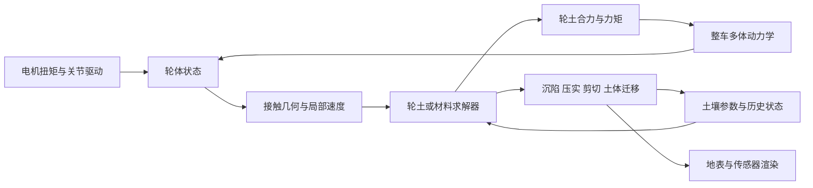

# Isaac Sim 地面与轮土／履土交互仿真调研

> **实施状态补充（2026-10-29）：** `five_surfaces` 已新增并默认启用 SCM 式履土原型，保留原单刚体与履带外包络，使用分布式接触、弹塑性承载、有界向量剪切与残余车辙；可切回原刚性基线。参数未实物标定，未加入完整土体流动。实现细节、运行入口和验证范围见 [SCM 模型说明](five_surfaces/docs/scm_model.md)。下文关于“当前仅完成刚性基线”的段落是此次改造前的调研快照；其中原生运行证据仍只对应其当时的代码与受力模型，不能移作 SCM 的精度或性能证据。

> 初版调研：2026-10-28；本地环境与实施状态更新：2026-10-29。当前对象是 L17 的双履带机器人，目标是在保留刚性基线的前提下，逐步研究滑移、沉陷与车辙。
>
> 证据范围分两层：S01–S44 保留初版外部资料、固定源码快照与静态核查结论，不表示本次逐条重新访问或运行；本次新增的本地事实来自 `isaacsim4.5` 环境、`ground/five_surfaces` 源码、配置、原生 PhysX 运行记录与交付校验。S45 为本次核对的资源配置说明。
>
> 当前仅完成五地面刚性基线；没有新增软土、滑移或沉陷模型，也没有做材料标定、候选求解器对比或性能基准测试。本文将“已实现”“已运行验证”“建议”“待验证”分别标明。本次只更新文档，不修改场景或动力学参数。

## 1. 当前项目的选型结论

**当前工程已从“空目录中的通用轮土调研”推进到“Isaac Sim 4.5 双履带五地面刚性基线”。下一步先完善履带接触与滑移观测，再决定土壤模型；本轮不修改地面物理。**

当前有效入口是 [five_surfaces 项目说明][L01]，使用 `isaacsim4.5`，而不是此前检查到的 `isaaclab` / Isaac Sim 5.1 环境。机器人是一个动态刚体加等效履带接触区，没有独立转动的物理履带链节、驱动轮关节或轮轴扭矩传感器。通用车轮论文中的 $R\omega$、轮轴扭矩、轮下接触弧不能直接当作本项目已有观测。

**降低摩擦系数不能替代软土力学。**当前五种地面只保留了 L17 原有的摩擦分区，名字“湿沙”“泥地”“河床”不代表已经具有含水、塑性、黏附、排水或土体流动机制。

按当前条件，保留三条后续路线：

1. **优先工程路线：保留 PhysX 整车积分，逐步接入标定的履土力模型与 SCM 式有状态网格。**先在现有四个等效接触区增加局部滑移、载荷与剪切历史观测；之后替换明确归属的切向力，再研究法向承载、沉陷和地形记忆。Bekker–Wong / Janosi–Hanamoto 可作理论基础，但须按履带接触长度、宽度和转向工况适配。只更改刚性地面摩擦仍属于基线实验。
2. **局部高保真对照：另建匹配环境验证 MPM / DEM。**先做压板和单履带接触区土槽，再决定是否改造整车碰撞体。当前 4.5 环境未接入 Newton；新版 Isaac Lab 的实验性接口与 5.1 桥接案例不构成 4.5 即装即用的证据。[官方 MPM 使用说明][S12]、[Terrain Lab 固定案例][S34]
3. **PBD 作为单独候选原型。**需要另建 GPU 粒子场景，核对 4.5 / Omni Physics 106.5.7 的接口、碰撞与测力；当前 CPU 刚性场景没有粒子土层。初版引用的 5.1 限制表只作为版本相关风险清单，不能直接视为当前 4.5 的运行结论。[粒子文档][S06]、[5.1 限制表][S07]

OmniLRS、Lproject_sim、Newton Terrain Lab 等仍作为方法与代码参考，继续保留第 6 节固定快照的证据边界；没有在本项目中安装或验证它们。PhysX Vehicle 主要面向轮胎／悬架车辆，也不是当前等效履带模型的直接替换。

## 2. 调研边界、版本和本地环境

### 2.1 “所有方法”的具体含义

公开资料无法证明覆盖每一个未公开插件、企业项目或研究分支。本文尽量覆盖目前公开可核查的**主要物理方法类别及代表性 Isaac Sim 实现**，并分成三种状态：

| 状态 | 含义 | 典型例子 |
|---|---|---|
| N：原生基础能力 | Isaac Sim / Omni Physics 中已有基础求解能力；不等于提供经过验证的土壤模型 | 刚体摩擦、Vehicle、柔顺接触、PBD、FEM |
| I：已有集成证据 | 有论文、源码或厂商案例，明确接入 Isaac Sim / Isaac Lab | OmniLRS、Lproject_sim、Newton Terrain Lab、SoftServe |
| C：可耦合候选 | 外部求解器已有相关物理能力，但本次未确认通用、可直接安装的 Isaac Sim 桥接 | Chrono SCM / DEM / CRM、RFT 自定义接入 |

“论文使用过”“代码里有公式”“公开演示能运行”“经过实验标定”“可以直接用于你的机器人”，是不同强度的证据。

### 2.2 本机环境：当前使用与历史候选分开记录

| 项目 | 当前核查结果 |
|---|---|
| 调研文档与场景目录 | `/home/touxinboy/HUST/isaacsim/ground`；已存在 `five_surfaces/`，不再是空目录 |
| 当前实验工程 | `/home/touxinboy/HUST/isaacsim/ground/five_surfaces` |
| 机器人来源 | `/home/touxinboy/HUST/isaacsim/L17/amphibious_project`；原样复制的文件由 [来源清单][L12] 记录 SHA-256 |
| 当前 Conda 环境 | `isaacsim4.5`，前缀 `/home/touxinboy/miniconda3/envs/isaacsim4.5` |
| Python / Isaac Sim pip 包 | Python `3.10.22`；`isaacsim==4.5.0.0` |
| 当前 VERSION 文件内容 | `4.5.0-rc.36+release.19112.f59b3005.gl`；pip 包版本与内部构建号分别记录，不混为安装错版 |
| Kit / 物理扩展 | `omniverse-kit==106.5.0.162521`；`omni.physx` 与相关物理扩展 `106.5.7` |
| 已安装依赖 | NumPy `1.26.4`、PyTorch `2.14.1`、OpenCV `4.11.0.86`；复建入口为 [environment.yml][L02] |
| 已验证使用的 GPU | NVIDIA GeForce RTX 3070 Ti Laptop GPU，8 GiB；单张 GPU |
| 当前求解分工 | CPU PhysX 积分刚体；GPU 0 渲染；场景明确设置 `physxScene:enableGPUDynamics=false` |
| 步长 / 控制 | 物理 120 Hz，即约 8.333 ms；直行控制约 20 Hz，见 [GroundRuntime][L09] |
| 新框架状态 | 当前 Conda 环境的包元数据中未注册 `newton`、`isaaclab`、`pychrono`；不能据此声称全机不存在其他环境或手工安装 |
| 并存的旧环境 | `isaaclab` 中仍有 Isaac Sim `5.1.0-rc.19+release.26219.9c81211b.gl`；它是初版核查对象，不是五地面场景的启动环境 |

当前 VERSION 路径为 `/home/touxinboy/miniconda3/envs/isaacsim4.5/lib/python3.10/site-packages/isaacsim/VERSION`。初版在旧环境中观察到的 `height_field_to_mesh`、柔顺材料、ParticleMaterial、DeformableMaterial 等入口保留为历史静态证据，不能移作当前 4.5 场景已启用的功能。

### 2.3 不能混用的版本与能力层次

- 当前代码与 USD 的判断以 **Isaac Sim 4.5 / Omni Physics 106.5.7** 为起点。S02、S07 的 5.1 内容，S06、S32、S33 的其他 Omni Physics 版本，以及 `latest` / `develop` 页面均需重新验证适配。
- 本次尝试访问 4.5 的旧版 physics resources 页面未成功，旧 Tensor API 页面也未取得内容；因此没有补写“4.5 已具备某项粒子／软土能力”的未经运行验证结论。当前接触与施力接口的有效证据是本项目代码和通过的运行记录。
- PhysX SDK、USD schema 中存在属性，与 Python 暴露、扩展启用、场景实际受力、目标材料标定是不同层次。
- Isaac Sim 新版 Newton 后端和 Isaac Lab 3.0 EA 的 MPM 接口不属于当前 4.5 基线。本文保留其初版资料索引，迁移或 worker 桥接必须在独立环境验证，不能升级现有环境后默认兼容。
- 初版固定的 OmniLRS `pixi.toml` 依赖 Isaac Sim `5.0.0`，与当前 4.5、并存的 5.1 均不一致。[固定依赖文件][S22]
- 配置 `cudaDevice=0` 或安装 PyTorch CUDA 依赖，不等于启用 GPU Dynamics、PBD 或 MPM；调用 Warp / Tensor API 也不等于土壤在 GPU 上求解。

### 2.4 已完成的五地面刚性基线 B0

场景为 [five_surfaces.usda][L16]：沿 +X 依次连接草地、干沙、湿沙、泥地、河床，每块 **4×6 m**、厚 **0.3 m**，共 **20×6 m**，所有顶面 Z=0。五块都是静态碰撞网格，没有隐藏的公共碰撞地板；数字与边界线仅用于显示。[布局配置][L03]

| 编号 | 地面 | X 范围 / m | 静摩擦系数 | 动摩擦系数 | 恢复系数 |
|---|---|---|---|---|---|
| 1 | Grass 草地 | -10 ～ -6 | 0.95 | 0.75 | 0 |
| 2 | DrySand 干沙 | -6 ～ -2 | 0.75 | 0.55 | 0 |
| 3 | WetSand 湿沙 | -2 ～ 2 | 0.65 | 0.45 | 0 |
| 4 | Mud 泥地 | 2 ～ 6 | 0.35 | 0.22 | 0 |
| 5 | Riverbed 河床 | 6 ～ 10 | 0.60 | 0.40 | 0 |

上述摩擦值、颜色和恢复系数沿用 [L17 地面配置副本][L15]；未标定真实草地、砂土或泥土。五地面场景不包含水体，“河床”只是第五块干燥测试地面的材质名称；推进器与水动力不参与本次运动。

机器人质量 **48 kg**，惯量对角为 `(4.0,5.4,7.5) kg·m²`，机体约 `1.0×0.6×0.36 m`；履带长 `1.06 m`、宽 `0.16 m`，中心距 `0.7 m`。初始位置 `(-8.5,0,0.24) m`，朝向 +X，重力 `9.81 m/s²`。机器人资产、机器人配置、原受力模块均为 L17 原样副本；未增加离散履带链节、土壤沉陷或新的滑移模型。[机器人参数][L04]、[机器人资产][L05]、[来源校验][L12]

### 2.5 当前实际受力路径与测量边界

当前基线属于“**刚性法向接触 + 自定义等效履带切向力**”，不是完全由原生摩擦驱动车辆：

| 物理项 | 实际负责者 | 对后续改模型的影响 |
|---|---|---|
| 重力、碰撞法向约束、刚体运动积分 | CPU PhysX | 刚性表面仍会阻止履带下陷 |
| 履带接触载荷 | 原生 contact report 的冲量除以对应物理 dt，再滤波 | 是接触载荷观测，不是土壤压力分布或电机测力 |
| 履带纵向／横向牵引、滚动阻力 | `AmphibianForces.compute()` 中每侧两个等效接触区，共四区 | 后续履土模型应替换明确的受力项，不能直接叠加重复计算 |
| 原生履带摩擦 | `TrackContact` 的静／动摩擦均为 0，combine mode 为 `min` | 履带—地面路径的切向力由外部模型提供；机体等其他碰撞对须另外审计 |
| 五种地面参数映射 | `FiveSurfaceEnvironment.ground_mu()` 按 collider 路径读取原有动摩擦系数 | **修改地面静摩擦字段不会自动改变自定义履带模型的牵引上限** |
| 土壤状态 | 尚无 | 没有承载本构、累计剪切位移、压实、残余车辙或土体搬运 |

现有履带速度状态有 `0.15 s` 一阶响应；载荷滤波时间常数 `0.035 s`。每侧纵向等效刚度为 `160 N·s/m`，每接触区横向刚度 `60 N·s/m`，滚阻系数 `0.015`；纵向力被分配到接触区的 $\mu N$ 限幅，剩余摩擦圆用于限制横向力。局部速度包含刚体角速度引起的 $\boldsymbol\omega\times\mathbf r$，最终合力及关于质心的合力矩施加到机器人，由 PhysX 积分。[受力模块][L06]、[接触与施力接口][L07]、[材质映射][L08]

`left_belt_m_s` / `right_belt_m_s` 是模型中的滤波履带速度状态，不是独立物理驱动轮的编码器测量；`left_traction_n` / `right_traction_n` 是模型输出，`torque_*_nm` 是所施加外力矩，不是电机轴扭矩传感器。现有机械功率也是模型代理量，不能标成实测电池能耗。

### 2.6 已完成验证及其边界

本次记录来自 [validation.json][L10] 与 [physics.csv][L13]：

| 项目 | 已记录结果 |
|---|---|
| 几何、碰撞与参数 | 五块地面、无间隙／重叠、原摩擦值、48 kg 质量、120 Hz 均通过检查 |
| 实际穿越 | 五种地面均有接触承重记录，机器人完成穿越并停车，结果 `completed` |
| 仿真时间与样本 | `41.66666884 s`，`5000` 条物理采样 |
| 终点原生位置 | `(8.62524,-0.01783,0.22000) m` |
| 终点水平速度 | 由最后一条 CSV 的原生速度计算，约 `0.0221 m/s` |
| 水动力 | 记录的浮力与推进器有效推力为零 |
| 交付校验 | 临时目录验证后复制到 `ground/five_surfaces`，交付场景 SHA-256 与已测场景一致，见 [delivery.json][L11] |

场景 SHA-256 为 `ddfacfcbd00994b3e5f1e0dd6136ed898f9874e1e7c55e6ac96bab711183774c`。`validation.json` 中的 `tested_project` 保留真实临时验证路径 `/tmp/l17_ground_stage/five_surfaces`，不将它改写成未执行的安装后复测；正式路径与一致性证据由交付记录说明。

以上证明场景、原接触与运动链路可用，**没有证明土壤沉陷、滑移率曲线、材料真实性或 MPM/DEM 精度**。当前直行指令为约 `0.45 m/s`，未必将牵引推到各材质极限；不同地面速度相近也不能解释为土壤物性相同。第五块还包含终点减速，不能把整块平均速度直接当作材质阻力实验。

总览：[实际渲染截图][L17]。启动命令：

```bash
source ~/miniconda3/etc/profile.d/conda.sh
conda activate isaacsim4.5
bash /home/touxinboy/HUST/isaacsim/ground/five_surfaces/start_here.sh
```

控制面板提供手动履带速度、复位、视角切换、自动穿越与 CSV 导出；加载 USD 文件本身不等于挂接了这些 Python 控制逻辑。

## 3. 需要模拟的物理量及判定标准

### 3.1 纵向滑移、侧滑和原地空转

车轮沿局部滚动方向的轮心速度记为 $v_x$，角速度记为 $\omega$，有效滚动半径为 $R_e$。一个便于工程记录的有符号滑移指标是：

$$
s = \frac{R_e\omega-v_x}{\max(|R_e\omega|,|v_x|,v_\epsilon)}.
$$

这里 $v_\epsilon$ 用于低速正则化；此式是本文建议的统一记录约定，**不保证与每个 Vehicle API、论文或数据集的 slip 定义相同**。对正向运动，$s\approx0$ 表示接近纯滚动，$s\approx1$ 表示驱动空转，锁止制动可接近 $-1$。倒车与转向时应同时保留有符号 $v_x$、$\omega$ 和实际接触相对速度，不能只看一个标量。

侧滑可记录局部横向速度 $v_y$，并用

$$
\alpha = \operatorname{atan2}(v_y,\max(|v_x|,v_\epsilon))
$$

作为一种记录约定。零速附近的滑移率、滑移角缺乏稳定意义，应改看接触相对速度、牵引力和驱动扭矩。实际轮心速度还应包含车体转动引起的 $\boldsymbol\omega_{body}\times\mathbf r$，不能用整车质心速度代替每个轮的速度。

**物理目标：**滑移应改变地面剪切、驱动力与扭矩，再影响车辆加速度；如果只是让视觉轮转快一点，得到的是经验/运动学复现。

**本项目的履带适配。**当前没有物理轮角速度，建议后续按每侧履带或每个等效接触区记录：

$$
s_i=\frac{u_{belt,i}-v_{patch,x,i}}{\max(|u_{belt,i}|,|v_{patch,x,i}|,v_\epsilon)}.
$$

这里 $u_{belt,i}$ 使用实际参与受力的滤波履带状态，而非输入指令；$v_{patch,x,i}$ 是将 $\mathbf v_{COM}+\boldsymbol\omega_{body}\times\mathbf r_i$ 投影到当地接触切向得到的局部速度。正负号需统一履带循环方向与车体 +X 约定。该式是待增加的诊断指标，不能称为已经由真实履带链节测得的滑移率。接触区的横向滑移和转向擦滑也须分别记录；单一车体中心速度不能代表四个接触区。

### 3.2 沉陷、弹性下压和永久车辙

三者要分别记录：

| 量 | 说明 | 容易混淆的现象 |
|---|---|---|
| 相对初始表面的几何沉陷 | 轮底相对于未扰动地面的下降量 | 接触 offset、轮胎压缩、悬架压缩 |
| 相对当前表面的接触嵌入量 | 用于接触/承载模型的局部侵入深度 | 将已压低的地形重复计入沉陷 |
| 卸载后的残余车辙 | 土体永久变形或搬运造成的表面变化 | 只在车轮接触时出现的弹性凹陷 |

在局部近似平面、轮半径固定的简化情形下，可用 $z=h_0+R_e-z_c$ 定义相对初始地面的沉陷。斜坡、轮胎变形或轮刺显著时，应按局部法向、实际轮廓和参考面计算，不能直接套世界坐标 Z 值。

本文把沉陷能力分为：

1. **视觉凹陷：**贴图、法线或渲染网格改变。
2. **柔顺下压：**接触弹簧允许轮体进入名义表面，卸载后无土体记忆。
3. **有状态地形：**高度、塑性沉陷、压实等历史保留，后轮经过会受到影响。
4. **土体流动：**土向侧方、后方迁移，能表现推土、堆积、抛散或破坏带。

达到第 1 层不代表达到第 3 层；达到第 2 层也不代表已经描述了真实土壤的塑性。

**当前基线的高度解释。**记录中机体原点终点高度约 `0.22 m`，对应履带外包络支承在 Z=0 地面；初始原点 `0.24 m` 到静置高度的变化属于落地过程，不能当作土壤沉陷。后续应按实际履带最低接触轮廓与初始／当前地表的相对位置定义沉陷，并排除接触 offset 与数值穿透。

### 3.3 土质需求会改变选型

| 目标地面 | 关键机制 | 优先关注的方法 |
|---|---|---|
| 沥青、钢板、硬土 | 接触摩擦、轮胎滑移刚度、载荷转移 | 刚体接触 / Vehicle |
| 松砂、月壤、干颗粒 | 压沉、摩擦剪切、剪胀、轮刺作用 | 标定轮土模型 / SCM / MPM / DEM |
| 碎石、砾石 | 颗粒旋转、形状嵌锁、局部翻滚 | 刚体颗粒 / DEM |
| 软弹性垫层 | 可恢复变形、接触面积 | FEM / 柔顺接触 |
| 泥地、湿黏土 | 屈服、黏性、黏附，可能还有孔压与排水 | 合适本构的 MPM / SPH / 外部多相求解 |
| 积水泥泞、饱和土 | 固液耦合、渗流、孔隙压力 | 专门多相模型；单纯“黏稠粒子”证据不足 |

## 4. 方法总览与能力矩阵

下表中的“可”表示方法具备相应机制或已有相应实现证据，**不表示已经对目标土壤完成定量验证，也不表示当前 4.5 工程已安装或启用**。当前只运行验证了第 2.5 节所述刚性基线。成本为同等任务下的定性工程判断，不能作为帧率承诺。

| 编号 | 方法 | 现状 | 滑移/牵引 | 承载沉陷 | 永久车辙/流动 | 成本与主要用途 |
|---|---|---|---|---|---|---|
| M1 | 刚性平面、网格、地形 + 库仑摩擦 | N | 可产生真实接触滑动；轮胎特性有限 | 无土壤沉陷 | 无 | 低；基线、硬地、粗糙路面 |
| M2 | PhysX Vehicle 轮胎模型 | N | 有纵/横向滑移力学 | 默认无软土沉陷 | 无 | 低至中；硬路面车辆动力学 |
| M3 | 柔顺接触；Newton hydroelastic | N，依版本 | 主要仍为界面摩擦 | 弹簧式下压 | 默认无永久土体状态 | 低至中；快速柔软表面近似 |
| M4 | 动态高度图 / 三角网格压印 | I | 必须另接受力模型 | 由附加规则决定 | 几何车辙可有；体积流动弱 | 低至中，碰撞更新可能昂贵 |
| M5 | FEM 软土层；伪塑性扩展 | N / I | 有摩擦接触 | 有变形；本构决定物理意义 | 原生弹性为主；伪塑性可留痕 | 中至高；弹性基底、小区域 |
| M6 | PhysX 固体 PBD 粒子 | N / I | 粒子接触阻力；有重要限制 | 可因颗粒重排产生 | 可有重排与堆积 | 中至高；颗粒原型 |
| M7 | 大量独立刚体颗粒 | N，需自建场景 | 接触与形状嵌锁 | 颗粒重排 | 可 | 高；小范围碎石 |
| M8 | Bekker–Wong / J–H 受力模型 | I，成熟度不一 | 模型计算牵引和阻力矩 | 模型计算 | 另接地形记忆 | 低至中；控制、整车机动性 |
| M9 | SCM 式有状态网格 | C；Chrono 已有 | 含剪切响应 | 可，含历史状态 | 可留车辙；三维流动近似 | 低至中；速度与物理的折中 |
| M10 | 经验回归滑移 + 柔顺沉陷 | I，论文实现 | 可复现实测滑移；可为规定式 | 可近似 | 附加轮迹模型 | 低；感知、任务级仿真 |
| M11 | RFT / 学习代理力模型 | C，基础研究已有 | 可预测作用力；依适用域 | 需动力学平衡/状态模型 | 需附加状态演化 | 低至中；快速自定义模型 |
| M12 | Newton 隐式 MPM | I，官方入口实验性 | 刚体-材料耦合后可产生 | 可 | 可表现连续介质塑性流动 | 中至高；局部高保真候选 |
| M13 | 专用 DEM，含 NDEM 等实现 | I / C，逐项目判断 | 可由颗粒作用涌现 | 可 | 可 | 中至极高；颗粒、轮刺研究 |
| M14 | 外部 CRM / SPH / 土壤 FEM | C | 耦合后可 | 合适本构下可 | 可，受方法与本构限制 | 中至极高；连续介质/多相问题 |
| M15 | Modelica / FMI 轮土协同仿真 | I，厂商案例 | 由外部轮土模型决定 | 由外部模型决定 | 渲染/地形需另接 | 中；已有工程模型复用 |

依据分别见以下各节。M4、M8、M9、M10、M15 可以组成同一系统；它们不是互斥的软件产品。M12 和 M14 中的“粒子”通常是连续介质采样点，与 M13 中一粒对应一个离散颗粒的含义不同。

## 5. 各方法详解

### 5.1 M1：刚性地面与摩擦接触

**原理。**地面由平面、静态三角网格或多个碰撞体表示，轮和地面接触后由法向约束与摩擦约束求解。PhysX 刚体采用静、动摩擦系数描述库仑摩擦。[PhysX 刚体动力学][S01]

**Isaac Sim 接入。**使用 GroundPlane、USD mesh collider 或 Isaac Lab terrain importer/generator；为轮、地面绑定 physics material，设置静摩擦、动摩擦、恢复系数与 combine mode。本地旧版 Isaac Lab 的 `height_field` 地形生成后转换为三角网格，并非自动获得随轮变形的原生高度场。新 develop 文档另有仅 Newton 支持的 heightfield 转换设置，必须区分。[新地形 API][S13]

**可以得到。**驱动扭矩超过可用附着时打滑，制动滑行、侧向滑动、粗糙表面引起的振动和载荷转移。

**得不到。**土层压实、轮底下沉、永久车辙、推土阻力、轮刺搬运土壤。减小摩擦只能减少界面切向支撑，无法自动增加压沉阻力或产生土壤历史。

**工程要点。**检查实际物理材质绑定；轮和地面的摩擦组合可能使预期低摩擦失效。驱动使用有扭矩上限的电机/关节模型，避免每步强制设置整车位姿或速度，使接触动力学失去决定权。碰撞近似必须保留需要研究的轮廓；将带轮刺轮子整体做成凸包会抹平凹槽。

**本项目落地。**五地面刚性对照组已经完成；其法向接触由 PhysX 处理，履带切向受力使用原自定义模型，具体参数与结果见第 2.4–2.6 节。单独这一基线不能满足软土沉陷需求。

### 5.2 M2：PhysX Vehicle

**原理。**Vehicle 以车辆刚体、悬架和专用轮胎模型计算轮载、纵向滑移、横向滑移和轮胎力。PhysX 文档描述了滑移刚度、载荷依赖，以及纵向 slip 对摩擦修正的曲线。[PhysX Vehicle 模型][S04]

**接入。**Omniverse 的 `omni.physx.vehicle` 扩展提供车辆配置入口；Vehicle Wizard 用于车辆、轮胎和悬架配置。它与常见 URDF 导入后“真实轮刚体 + 转动关节”的机器人搭建方式不同，迁移需要重新确认动力学结构。[Vehicle 可视化配置][S03]

**对研究的价值。**硬地车辆的 slip–force 响应比仅使用一个库仑摩擦系数更丰富。Omniverse telemetry 能提供轮速、接地状态、纵横向 slip、悬架力、轮胎摩擦和相关力信息，适合制动、防滑和车辆稳定性试验。[Vehicle telemetry][S05]

**边界。**默认轮胎力模型是道路接触模型，不是土壤塑性模型。它不会自动建立轮陷深度、土体剪切位移、推土阻力或车辙。将道路摩擦曲线拟合成砂地曲线，也只是等效模型。

**集成风险。**底层 SDK Vehicle2 支持组件扩展，不代表 Isaac Sim Python 已向用户暴露全部自定义组件能力。若另外施加轮土力，要避免与 Vehicle 轮胎力重复计算；颗粒介质也不能直接按普通刚性道路查询来替代。

**结论。**硬地轮式车辆滑移研究候选；软土问题需额外轮土模型。当前 L17 是等效履带刚体，不采用 Vehicle，不能通过更换一个地面材质直接获得 Vehicle 的轮速、悬架或轮胎遥测。

### 5.3 M3：柔顺接触与 hydroelastic 接触

**PhysX 柔顺接触。**通过材料刚度和阻尼，将法向接触近似成弹簧阻尼响应。概念式为：

$$
F_n\approx\max(0,k\delta+c\dot\delta).
$$

此式用于解释机制，不是对底层离散求解器的逐项复刻。正的 $\delta$ 表示压入。在简化单自由度、force-spring 条件下，静态下压可由 $\delta\approx W/k$ 估计。[5.1 柔顺接触][S02]

**接入。**PhysX 材料设置 `compliantContactStiffness` 与 `compliantContactDamping`；本地 Isaac Lab 也提供相应配置。需检查 force spring 与 acceleration spring 选项、单位、材质组合以及多个接触点的总响应，不能把材料属性不经验证地解释为整只车轮的单根弹簧。[刚体柔顺材料细节][S08]

**能模拟的层次。**轮体在负载下进入名义地面、产生垂向缓冲；配合回归可近似目标沉陷。它不保存压实或残余塑性，没有独立的土体剪切场。

**Newton hydroelastic。**通过接触面积上的压力/柔顺分布改善接触力和力矩的计算。它解决的是柔顺接触面问题，不会自动生成颗粒流动或不可逆车辙；具体刚度效果还与所选求解器有关。[Hydroelastic 官方说明][S11]

**结论。**适合快速垂向下压近似、等效柔性地面和经验模型复现。若要求多次碾压后的地面变化，必须再引入状态变量。

### 5.4 M4：动态高度图、网格压印与轮迹渲染

**原理。**用 $h(x,y)$ 表示表面，依据轮子经过位置、轮宽、轮刺几何、法向力或 slip 对网格做压印。渲染可以采用 mesh、法线、位移贴图或额外 ribbon mesh。

**实现层次。**

| 实现 | 相机可见 | 车辆接触一定更新吗 | 可单独预测轮土力吗 |
|---|---|---|---|
| 法线/凹凸贴图 | 具有光照凹凸感，轮廓有限 | 否 | 否 |
| Ribbon 轮迹 | 可见轨迹，几何方式各异 | 通常不参与碰撞 | 否 |
| 只更新渲染 mesh | 可见形变 | 需检查是否与 collider 共享及是否触发更新 | 否 |
| 更新物理查询高度数组 | 自定义模型可读取新高度 | PhysX collider 未必同步 | 否，需受力模型 |
| 更新 collider + 土壤状态 | 可形成物理车辙 | 可，但有 cooking/同步成本 | 取决于另接的受力模型 |

**代表实现。**OmniLRS 的变形引擎和 Lproject_sim 的 CPU 高程压印、ribbon 轮迹；其具体动态路径见第 6 节。[OmniLRS 地形代码][S20]、[Lproject 主循环][S24]

**重要限制。**PhysX SDK 的可修改 heightfield 与 Isaac Sim 集成不是同一层能力。2025 年 NVIDIA 对具体提问的回复指出当时 Isaac Sim 未集成该 heightfield 接口；应将其视为历史版本信息，不能扩展成所有新后端永不支持。[heightfield 集成讨论][S15]

**工程建议。**在轮附近更新局部 patch；分别测量高度数据更新、渲染上传和碰撞重建成本。轮迹形变量应与土壤承载/剪切模型共享状态，并记录挖走与堆积的体积。压印若只持续减小高度，会无限失土和无限下陷，必须设置压实、卸载与极限规则。

**结论。**适合管理车辙和视觉表现，是轮土模型的配套层；单独不是力学求解器。

### 5.5 M5：FEM 可变形土层与伪塑性

**原理。**将有限厚度地层离散为四面体等单元，通过连续体变形计算接触响应。Isaac Sim / Omni Physics 提供 GPU 可变形体基础能力，旧新 deformable schema 和 API 存在差异。[旧版 FEM 官方说明][S32]、[新 deformable 官方说明][S33]

**接入。**建立有厚度的实体土块，指定密度、杨氏模量、泊松比和阻尼；底部和边界施加约束；轮体与其碰撞。地层表面网格、碰撞网格和仿真网格分辨率不一定相同，应逐一检查。

**适合。**轮压弹性垫层、橡胶/泡沫表面、局部软地面，或对柔性轮胎本身的建模。

**局限。**“物体可变形”与“有土壤弹塑性本构”是不同条件。原生软体入口不应直接当成具备摩擦屈服、压实硬化、剪胀和土体破坏的通用地质 FEM。弹性土块可能在轮离开后回弹，无法代表砂地的永久车辙。

**已有伪塑性实现。**`hijimasa/isaac-sim-plastic-deformation` 面向 5.1：利用应力判断冻结节点位置、将冻结节点速度清零，以抑制弹性恢复。项目明确将其称为 pseudo-plastic approximation。[项目原始说明][S31]

**对伪塑性的判断。**节点冻结可产生永久凹痕，但会额外约束运动并改变能量、应力传递和后续承载；Von Mises 式判据也不能直接等同砂土的压力相关摩擦屈服。尚无本次核查到的轮土标定证据。因此可用于演示和机制实验，不建议直接作为牵引力或深陷预测基准。

**结论。**普通弹性 FEM 不是松砂首选。若采用土壤 FEM，应明确本构、塑性积分、接触与大变形处理；必要时使用外部专用求解器。

### 5.6 M6：PhysX 固体 PBD 粒子

**原理。**以粒子集合表示散体，使用 Position-Based Dynamics 约束处理相互作用。固体粒子能重排、成堆并与刚体/关节机器人耦合；其求解思路与完整工程 DEM 不同。[Omni Physics 粒子文档][S06]

**接入步骤。**创建 GPU physics scene、particle system、solid particle set 和 PBD material；用土槽碰撞体约束颗粒；轮体采用受支持的碰撞形状；让颗粒先沉降后加载。应确认 `fluid=False` 等固体设置，避免误把流体粒子当砂。

**可出现的现象。**粒子重排导致承载下沉、轮前土堆、轮后凹槽、颗粒飞散与接触滑动。这些现象是否达到定量精度，需要单轮实验验证。

**初版 5.1 资料中的相关限制（用于风险识别，当前 4.5 尚未逐项运行复核）：**

- 粒子/可变形体不支持通常的静摩擦机制，不能将刚体材料的静动摩擦经验直接移植过去。
- 不支持常规粒子/可变形体接触报告，因此不能默认直接取得逐轮逐接触的力分解。
- 文档列出 ghost forces，粒子可能在水平表面出现非预期移动。
- 某些 CPU custom geometry 与 GPU 粒子不碰撞；原生 cylinder/cone 形状是否走自定义几何路径需要核实。

以上依据 [5.1 官方限制表][S07]。力测量可另设轮轴传感器、受约束单轮测力台或动量平衡，但必须验证这些观测与真实接触合力的一致性。

**参数含义。**渲染球半径不等于接触半径；solid rest offset、particle contact offset 与粒子-刚体 rest offset 的作用也不同。官方粒子密度到质量的计算采用自身的体积约定，不能直接拿可见球体体积反推质量。[粒子 offset 与质量规则][S06]

**已有示例。**DeformableIsaac 的四足任务实际包含 particle system / material / reset 与地形查询代码；它证明存在 PBD 地面集成路径，未证明轮式机器人牵引力模型经过验证。[任务源码][S29]

**结论。**保留为独立局部土槽候选。当前五地面未启用 PBD；在 4.5 上开始试验前，要先确认该版本 API、GPU 粒子与履带碰撞代理的兼容性、测力方式和基础稳定性，不把 5.1 表格直接当作已验证的 4.5 结论。

### 5.7 M7：大量独立刚体颗粒

**原理。**用球、凸多面体或复合形状代表每个石子，直接由刚体接触求解颗粒间和轮-颗粒间作用。

**接入。**利用 PhysX 常规动态刚体能力构建土槽与颗粒；可使用 GPU 刚体加速，但具体碰撞形状和执行路径要按对应版本核实。

**适合。**少量至中等规模的大砾石、块石路面，研究轮子挤压、滚动和石块翻转；不适合将真实细砂每粒都建成独立 USD 刚体。

**与 PBD / 专用 DEM 的区别。**常规刚体颗粒有刚体转动和形状，但默认不自动具有工程 DEM 所需的接触切向历史、滚动阻力、黏聚/键合和目标接触刚度模型。它能表现散体行为，却不能因此宣称等同经过标定的岩土 DEM。[刚体接触基础][S01]

**成本。**减小粒径后颗粒数约按长度尺度三次方增加；小颗粒与大场景组合会迅速放大接触、内存与稳定性成本。颗粒过大又会改变轮刺与土壤的几何比例。

**结论。**碎石地面候选；细砂与月壤建议考虑 MPM 或专用 DEM。

### 5.8 M8：Bekker–Wong 与 Janosi–Hanamoto 轮土力模型

**原理。**用压力-沉陷规律计算法向应力，用剪切位移规律计算切向应力，再沿接触区积分得到力与力矩。常用基本形式为：

$$
p=\left(\frac{k_c}{b}+k_\phi\right)z^n,
\qquad
\tau=(c+p\tan\phi)\left(1-e^{-j/K}\right).
$$

其中 $b$ 为接触特征宽度，$z$ 为压沉，$j$ 为累计剪切位移，$K$ 为剪切变形长度，$c$ 为黏聚力，$\phi$ 为内摩擦角。Bekker 参数 $k_c,k_\phi,n$ 来自土壤试验。不同改进模型的符号、宽度和接触几何定义可能不同。[Chrono SCM 说明][S26]、[SCM/CRM 参数对比][S27]

**为什么适合滑移与沉陷。**滑移增大改变接触区剪切位移，进而改变牵引力；载荷改变沉陷和接触面积，再改变法向与剪切应力。车轮转得更快却不前进、滚阻增加、载荷增加更易陷入等趋势，可以进入同一受力闭环。

**必须补全的内容。**仅有上述两条公式还不够，需要接触入口/出口角与应力分布、法向平衡、滑移/刹车/倒车处理、轮刺作用、压实阻力、推土阻力、侧向力和转向阻力矩。经典二维纵向模型不能直接用于差速原地转向。

**接入方式。**每个 physics step 从轮 link 读取位姿与速度，按地形法向构造局部坐标，计算 $F_x,F_y,F_z$ 与轮轴阻力矩，转换回世界坐标并施加到轮体或等效位置。轮土反作用经关节传到车体，由 PhysX 积分整车运动。

**沉陷解法。**准静态情形可求解 $F_z(z)=W_i$；动态情形则应让轮的垂向动力学与法向模型共同决定 $z$，或采用经过验证的动态沉陷状态方程。不要把整车总重均分当成动态轮载，尤其在坡道、加速和不平地面。

**已存在的 Isaac Sim 路径。**OmniLRS 仓库包含传统轮土求解器，Lproject_sim 包含相关公式与阻力实现，SoftServe 展示过外部 terramechanics 协同仿真。它们的完成度和受力路径差异很大，详见第 6 节。[OmniLRS 求解器][S19]、[Lproject 代码][S24]、[SoftServe 一手案例][S35]

**结论。**整车控制与软土机动性研究的优先候选。需要标定，且需要自行检查现有代码的闭环完整性。

### 5.9 M9：SCM 式有状态土壤网格

**原理。**在地面网格保存塑性沉陷、可恢复变形、剪切位移等历史，根据接触压力和剪切规律更新节点，随后计算接触力。Chrono 的 `SCMTerrain` 是公开可用的代表实现，采用稀疏维护受扰节点等机制控制成本。[Chrono terrain][S26]

**相比只有轮土公式的改进。**前轮压实后的状态会影响后轮；再次碾压同一区域不必重复当作新土；能形成持续存在的车辙，适合研究陷车、脱困和多轮重复通过。

**局限。**本质上仍以表面节点的法向变形为主，不是完整三维土体流动。大范围侧向推土、抛土、堆积、塌落和掘进依赖额外近似。若不更新剪切记忆或卸载曲线，它就退化成几何压印。

**与 Isaac Sim 的关系。**本次确认的是 Chrono 中存在成熟接口；未确认官方提供通用的 Isaac Sim 即插即用 SCM 插件。可自行重写/移植模型，或让 Chrono 计算轮土力、Isaac Sim 负责整车与传感器；也可让 Chrono 负责整车与土壤，将位姿同步到 Isaac Sim。两种架构要选定一个权威积分器。

**标定依据。**已有论文用高保真 DEM 虚拟 bevameter 标定 SCM，并比较单轮与整车结果。论文中的加速比只适用于其具体实验，不能直接承诺在 Isaac Sim 中相同。[DEM 标定 SCM 论文][S28]

**结论。**如果需要可持续演化的车辙、轮载-沉陷与牵引闭环，又希望控制计算量，SCM 式方案非常值得优先实现。

### 5.10 M10：经验回归滑移、柔顺沉陷与轮迹组合

**原理。**根据实测或高保真仿真，拟合 $s=f(v_w,\text{slope},\ldots)$、$z=g(s,F_z,\ldots)$，再通过驱动修正、接触刚度和地形变形复现目标行为。

**已实现例子。**2026 年 OmniLRS 相关论文使用经验滑移模型，区分视觉轮与物理轮驱动，以柔顺接触复现沉陷，并增强轮迹变形。[论文方法章节][S17]

**应如何理解。**如果物理轮按修正后的速度滚动，而视觉轮按原始命令旋转，看到的打滑并非接触求解器从轮土剪切中自行计算出来。该设计可用于复现目标速度损失和图像表现，但不能自动回答改变电机扭矩、轮刺或轮宽后牵引力怎样变化。

**优点。**计算轻、容易拟合指定车辆和土槽数据，适合任务规划、视觉里程计、滑移检测和导航测试。

**局限。**适用域由标定数据决定；速度、坡度、土质、轮载或车辆几何改变后需要复核。横向滑移、高 slip 深陷、反复碾压和脱困可能超出训练/拟合分布。不同轮的载荷差异也不能用整车一个回归值简单替代。

**结论。**适合“重现已知行为”；若核心问题是“预测未知设计的轮土动力学”，优先考虑 M8/M9/M12/M13。

### 5.11 M11：RFT、神经网络和降阶代理力模型

**RFT。**将浸入土中的轮面离散为小面元，依据面元深度、朝向和运动方向估计局部阻力，再积分合力与力矩。已有单轮实验论文比较 RFT、传统地面力学与 MPM，说明其作为快速轮土力预测方法的价值；该论文不等于提供了 Isaac Sim 插件。[RFT 原始研究][S30]

**学习代理。**可训练 $\mathbf F,\mathbf M,\dot q_{soil}=f(z,s,\alpha,F_z,\text{soil state},\text{geometry})$，用 DEM/MPM 或土槽数据作为监督，再把结果施加到 Isaac Sim。这里给出的是工程候选架构，本次未确认一个覆盖这些输入与现象的通用现成插件。

**关键条件。**代理需要土壤状态和动作历史，否则无法区分新土与车辙、加载与卸载。数据必须覆盖滑移、轮载、速度、侧偏和材料变化；输出应检查坐标、量纲、对称性、耗散和离群值。

**结论。**适合已有可靠数据后的加速阶段。数据来源本身不准确时，代理会高速复现错误。

### 5.12 M12：Newton 隐式 MPM

**原理。**Material Point Method 将质量、速度、应力和历史变量保存在材料点，在背景网格上求解动力学后回传。材料点代表连续介质采样，不要求等同一粒真实砂。Newton 的 `SolverImplicitMPM` 面向颗粒/弹塑性介质，官方说明包含压力相关屈服、黏性、剪胀及硬化/软化等机制。[Newton 求解器 API][S10]

**与轮土问题的关系。**合适本构和双向刚体耦合下，轮载会使土体屈服与迁移，轮旋转会引起剪切和土体流动，滑移、牵引与沉陷可在同一材料动力学框架内形成。结果精度仍依赖土体参数、边界、网格分辨率和耦合精度。

**官方接入状态。**Isaac Lab 3.0 EA 提供 MPM object、spawner 和 solver 配置，推荐从 `scripts/demos/mpm/newton_mpm_granular.py` 等示例开始；文档明确将 MPM 与 rigid-MPM coupling 标为实验性。[Isaac Lab MPM][S12]

**三种不同的运行方式：**

1. Newton 独立运行刚体与 MPM，用其示例先验证物理机制。
2. 在匹配版本的 Isaac Lab 中采用 Newton 与耦合接口，使用 Isaac Sim 等渲染器。
3. 保留 PhysX 机器人，外部 Newton worker 计算材料接触，按步返回合力/力矩；此路径需要自定义桥接。

这三者不能用“切换到 Newton”一句话概括。Isaac Sim 当前 Newton 后端页面并没有因此承诺自动把现有 PhysX USD 粒子和机器人变成完整 MPM 场景。[Isaac Sim Newton 后端][S09]

**已有 5.1 集成证据。**Newton Terrain Lab 报告 PhysX articulation + 独立 Newton MPM worker，交换状态并将材料 wrench 施加到下一宿主步；它明确承认一拍延迟、材料未标定和实验范围限制。[项目 README][S34]、[实际控制回路报告][S37]

**工程重点。**控制 voxel size、每格采样点、粒子数、子步、非线性迭代、碰撞代理与摩擦。网格足够稳定并不等于力学误差已收敛；隐式稳定性也不能消除过粗时间步导致的精度和耦合问题。官方耦合框架还指出虚拟惯量、调度、迭代及刚度会影响稳定性。[耦合框架源码说明][S14]

**结论。**当前很值得验证的高保真候选，尤其适合需要土体流动又希望留在 NVIDIA/Warp 生态内的项目。对本机应另建匹配版本试验环境，先做单轮土槽。

### 5.13 M13：专用 DEM 与商用颗粒引擎

**原理。**每个离散颗粒具有平动、转动和接触相互作用，可按模型包含法向刚度/阻尼、切向历史摩擦、滚动阻力、黏聚或非球形颗粒。车轮牵引、土体剪切、重排和沉陷由大量颗粒接触产生。

**适合的问题。**轮刺间距与颗粒尺度相近、颗粒形状嵌锁、局部掘进、强抛散和粒径级配影响。若任务是改变车轮几何并预测牵引，DEM 很有研究价值。

**外部开源路线。**Chrono 有 granular terrain 与相关协同仿真节点，是外接候选。已有 NASA/VIPER 等相关研究使用 DEM 分析轮土动力学；这不构成已经接入 Isaac Sim 的证据。[Chrono terrain][S26]、[Chrono terrain 节点][S39]

**已有 Isaac Sim 商用展示。**VeloxSim 的 palm-rover 页面明确列出 Isaac Sim 渲染、ROS 2 和 NDEM 地形，厂商主页还宣称已演示与 Newton Featherstone 的双向耦合。[原始轮式案例][S36]、[厂商技术说明][S38]

**证据强度。**上述厂商信息支持“存在此类集成展示”，尚不能替代可复现代码、目标土壤的标定数据、轮土受力误差和批量运行性能。其“实时”“大时间步”等数字需按硬件、粒子规模和精度条件单独验收。

**成本与误差。**传统高刚度 DEM 往往需要小时间步。降低刚度、放大粒径或增大数值阻尼可以提速，但可能改变压沉、剪切带和轮土力。不能只拟合安息角就宣称完成轮土标定。

**结论。**对颗粒尺度机制优先；整车大地图可采用局部活动区或用 DEM 标定低阶模型。

### 5.14 M14：外部 CRM / SPH / 专用土壤 FEM

**CRM / SPH。**连续介质法以材料采样点和邻域运算描述土体应力和流动，和流体 SPH 共享部分数值框架，但必须有适合土壤的流变与屈服模型。Chrono CRM 已提供专门地形接口，官方给出了与 SCM 的物理、配置和耦合差异。[CRM 官方说明][S27]

**能力。**合适本构下可模拟连续土体变形、推土与较复杂接触几何。把普通液体的黏度调大，只能得到特定黏性介质近似，不能直接替代干砂或湿黏土。

**专用土壤 FEM。**若需要压实、孔压、排水或特定黏土/饱和土本构，可使用专用连续体求解器，再与整车动力学或渲染协同；本次未确认通用现成 Isaac Sim 插件。

**接入选择。**外部求解器负责整车和土壤、Isaac Sim 接收变换与地表；或者 Isaac Sim 负责整车，外部只返回轮土 wrench。后者需要处理姿态、关节、接触几何、力矩参考点、步长和延迟。

**轮胎模型兼容性。**以 Chrono CRM 为例，官方提示不能将其直接当作常规 handling tire 的高度/法向查询地面，而应使用在 FSI 中注册的刚性或 FEA 轮胎。这说明“地形支持车辆”仍然需要核对具体接触接口。[CRM 接口限制][S27]

**结论。**针对连续土体流动或更复杂本构的外接路线；不能将 Chrono 自有能力写成 Isaac Sim 原生能力。

### 5.15 M15：Modelica / FMI 协同仿真

**原理。**将轮土力学封装为外部模型或 FMU，由 Isaac Sim/PhysX 提供运动状态，外部计算作用力和力矩，再反馈给多体系统；渲染地形与可见颗粒可采用另一条更新链。

**已有证据。**SoftServe 的 L-REX 一手案例说明使用 Modelica terramechanics 与 FMU/FMI，PhysX 负责多体仿真，Warp 用于被挖起颗粒的可视化。公开的车辆机动性演示资料还列出刚性轮、柔性轮、轮刺、剪切与 slip-sinkage 模型。[L-REX 技术栈][S35]、[车辆机动性公开演示][S40]

**对本任务的意义。**如果已有成熟的车辆/土壤工程模型，复用模型比在 USD 中重造公式更实际；但是否输出真实接触 wrench、哪些土体状态有记忆，仍由外部模型决定。

**边界。**公开案例不意味着提供可自由下载的通用插件；Warp 粒子用于可视化，也不自动意味着每个粒子参与轮土受力求解。

**结论。**已有工程模型或供应商支持时可行；需确认接口、许可、步长与标定交付物。

## 6. 代表项目的实际实现与源码核查

### 6.1 OmniLRS：不能只看项目功能列表

**定位。**基于 Isaac Sim 的月面机器人模拟器，包含月面生成、光照、岩石、传感器、ROS 和局部地形变形。它适合复用场景与感知基础设施，但对轮土力学应逐条审查。[项目仓库][S18]

**三个层次：**

| 层次 | 公开内容 | 对滑移/沉陷的含义 |
|---|---|---|
| 2024 轮迹论文 | 由接触法向力回归形变量，使用轮迹/轮刺轮廓生成形变 | 主要支持轮迹重现；不能据此推断完整牵引闭环 |
| 2026 数据驱动论文 | 经验 slip，视觉/物理轮分离，柔顺接触沉陷 | 适合目标车辆经验复现；不是颗粒剪切涌现的 slip |
| 本次检查的 main 源码 | 有形变引擎与传统轮土求解器，但关键调用仍存在占位 | 需核查具体启动场景和分支是否使用完成的模型 |

论文依据：[2024 方法][S16]、[2026 方法][S17]。

**源码固定快照：**`7fd43573772a445a04a38b113bb4d91e6018505e`。静态检查发现：

1. `terramechanics_solver.py` 的类说明标为 **WIP**；`compute_force_and_torque()` 中 `fy = 0`，侧向力和若干力矩分量未实现，不能用于宣称完整差速转向轮土力学。[固定源码][S19]
2. `terrain_control_mixin.py` 的 `apply_terramechanics()` 先将 `sinkages` 设为零，再传给求解器。这个调用没有提供实际沉陷状态，也不能由方法名推断已接通自洽的沉陷闭环。[固定调用处][S21]
3. 求解器使用逐轮 SciPy 积分，并存在需要重新核对的实现细节，例如低速除法保护、`theta_f` 的几何定义、积分函数返回值处理和硬编码 `9.81`。这些是静态审查发现的风险，本文未运行并确认所有路径都会触发故障。[固定求解器][S19]
4. `deformTerrain()` 更新 DEM 后调用 `update(update_collider=False)`，路径明确修改 mesh points，没有显式调用 `updateTerrainCollider()`。**不能据此断言 collider 永远不变：**mesh 共享关系、USD change tracking 和 cooking 仍可能导致更新，需运行测量。本次证据只说明不能从该代码直接证明稳定、高效的双向车辙接触。[地形更新代码][S20]
5. 依赖文件固定 Isaac Sim 5.0.0；对当前 4.5 工程或并存的 5.1 环境都需另行迁移验证。[依赖文件][S22]

**复用建议。**优先复用地形、轮迹与传感器；轮土受力接口单独封装并验证。若使用 2026 论文方法，应确认对应实现分支或提交，不能假定当前 main 的 WIP 求解器就是论文实现。

### 6.2 Lproject_sim：公式文件存在，不代表主循环使用完整求解器

**定位。**Isaac Sim 5.0 月面 rover 平台，README 宣称包含 Bekker 轮土交互、沉陷、slip 与 drawbar pull。[项目仓库][S23]

**固定快照：**`5c179dbcaef07e59d100ce7f5dcb004c538178a5`。本次检查 `terramechanics.py`、`physics_manager.py`、`deformation.py` 后发现：

- 独立 solver 文件有逐轮力/矩计算；但所检查的 `PhysicsManager` 主路径创建 solver 后，实际采用另写的平均沉陷、压实阻力与推土阻力计算，没有在此路径调用 `self.solver.solve()`。[主循环源码][S24]、[solver 文件][S25]
- 主路径使用均分静态轮载与固定月球重力近似；阻力经缩放、限幅、平滑后作为水平力施加到 rover。它不等于逐轮三维轮土 wrench 闭环。
- 变形主要分成 ribbon 视觉轮迹与 CPU DEM 数组更新，`update_mesh` 默认关闭。CPU 高度数组变化可以影响自定义高度查询，但不能自动证明 PhysX 的实际碰撞表面同步下沉。
- 代码提供最小沉陷值与 `visual_scale`，因此显示或记录出的“sinkage”应核对是否为物理轮真实下降量，不能直接用作实验沉陷数据。

这些判断依据固定的 [PhysicsManager][S24]，未对项目所有场景与替代入口做运行验证。

**结论。**可作轮迹、ROS 与地形组织参考；直接用于牵引力-沉陷预测前，需要重构实际受力路径并标定。

### 6.3 DeformableIsaac：已有 PBD 地面代码，但对象主要是四足

仓库保留旧 OmniIsaacGymEnvs 风格任务。`anymal_terrain.py` 中实际包含 PBD material、particle system、初始粒子缓存、重置和粒子地形查询逻辑，属于可参考的真实实现。[固定任务源码][S29]

作者项目页给出颗粒地面上的四足 locomotion 演示，也存在版本和实现细节需要核对的描述。因此本文不将其网页中的所有性能/粒径/CPU-GPU 说法作为权威结论；PBD 后端性质以 NVIDIA 官方文档为准。[作者项目页][S41]、[官方粒子说明][S06]

**可复用：**土槽、粒子初始化、reset、地形查询、训练组织。**仍待完成：**轮式单轮测力、滑移率扫描与沉陷误差验证。

### 6.4 Newton 官方：已有 MPM 与耦合代码，仍需应用验证

本次固定 Newton main 快照为 `ea38d214e803c20b023af9b74c3506b537c3c372`。仓库包含 `example_mpm_twoway_coupling.py` 和多种 coupled solver 示例；官方 Isaac Lab EA 文档也提供 MPM 入口。[官方示例目录][S42]、[Isaac Lab MPM][S12]

但“有双向耦合示例”不是“已有经过土槽验证的你的车轮模型”。材料参数、轮刺分辨率、土槽底部、接触摩擦与整车驱动，需要作为一个新实验系统重新校核。

### 6.5 Newton Terrain Lab：保留 PhysX 的 MPM 桥接实例

**固定工具仓库快照：**`9bfb0b3957125d63d3d001b794485cd4eaaef699`。

该项目有 terrain generator、Isaac 接口和材料 worker 相关工作流。报告明确描述 PhysX articulation 由宿主积分，Newton MPM 在独立进程中步进，返回 world-frame force 与 COM torque；存在一宿主步的显式耦合近似。[README][S34]、[实验报告][S37]

应注意：报告中的沙/泥是未按实土标定的展示预设，任务是人形动作跟踪，未证明轮土动力学。报告还明确说明公开 toolkit 本身不能完整复现外部研究环境。地图有许多 tile，也不表示同样数量的 MPM 环境同时高效求解。

**价值。**证明“Isaac Sim 5.1 / PhysX 机器人 + 外部 Newton MPM”是可研究的集成方向；可参考交换 wrench、选择性 reset 和材料表面同步的设计。

### 6.6 FEM 伪塑性、商业集成与其他候选

| 项目 | 已核查的内容 | 适合复用 | 不能直接声称 |
|---|---|---|---|
| Isaac Sim Plastic Deformation | 5.1 FEM 节点冻结、抑制回弹的扩展说明 | 永久凹痕原型 | 经过验证的土壤塑性和轮土牵引 |
| VeloxSim NDEM | 轮式 Isaac Sim 展示；厂商声明 Newton 双向耦合 | 商业方案评估 | 未经验收的误差与性能承诺 |
| SoftServe / Modelica | Isaac Sim、FMI、外部 terramechanics 一手案例 | 工程协同仿真架构 | 现成开源通用插件 |
| RoSE_Lab_Terramechanics | 有 Python rover/轮土分析代码；本次检查的模拟器文件未见 Isaac 接口 | 轮土公式/分析参考 | 已确认完成 Isaac Sim 地面集成 |
| AGX Terrain | 官方提供形变土壤产品和其他引擎集成 | 外部商业备选调查 | 本次未确认 Isaac Sim 通用插件 |

来源：[伪塑性说明][S31]、[NDEM 轮式演示][S36]、[SoftServe][S35]、[RoSE 代码][S43]、[AGX 官方地形说明][S44]。

## 7. 为什么“能滑、能陷”仍然不足以证明模型正确

### 7.1 需要验证的是闭环，而不只是形状

合理的闭环应满足：



如果实际数据流只有“接触力 → 压印轮迹 → 渲染”，就没有形成土壤状态到后续受力的反馈。如果只有“目标 slip → 直接修正车辆速度”，应将其归类为经验运动重现。

### 7.2 接触力的所有权

| 架构 | 法向承载 | 切向牵引 | 适用与风险 |
|---|---|---|---|
| 原生刚体 | PhysX | PhysX 摩擦 | 硬地基线 |
| 增量修正 | PhysX | PhysX + 附加压实/推土等增量项 | 容易接入；需证明没有重复计算相同物理项 |
| 分离切向 | PhysX/柔顺接触 | 外部轮土模型；原生切向需禁用或有效抑制 | 定量控制较好；必须验证每种碰撞对与驱动路径 |
| 完整轮土接触 | 外部模型 | 外部模型 | 能自洽求沉陷；需处理岩石、底部、边界与穿透保护 |
| MPM / DEM 双向 | 材料-轮耦合 | 材料-轮耦合 | 信息更丰富；避免再叠加经验牵引力 |

“在刚性地面上再添加一套完整 $F_z$ 与 $F_x$”常会导致双倍承载或牵引。应逐项列出力的来源，通过关闭单项、静止加载与能量检查验证。

**当前工程对应关系。**五地面基线接近本表“分离切向”一行：PhysX 提供法向承载，自定义履带模型提供切向力与其力臂矩。后续接入履土模型时，不能在原 `AmphibianForces` 的牵引／滚阻上再叠加一整套相同物理项；法向承载若改由土壤模型计算，也必须同时处理原刚性地面的支承约束。机体外壳等其他碰撞对、土槽底板与边界仍需单独保留或过滤，不能简单关闭全部碰撞。

### 7.3 力矩参考点与时间同步

外部返回点力 $\mathbf F$，作用点为 $\mathbf p$，轮 link 质心为 $\mathbf x_c$ 时，关于质心的力矩为：

$$
\mathbf M_c=\mathbf M_p+(\mathbf p-\mathbf x_c)\times\mathbf F.
$$

若接口已在接触点施加力，再额外添加同一个力臂矩，就会重复计算。若返回的是冲量，必须除以对应物理步长转换为平均力；不能误除渲染帧间隔。

跨求解器显式耦合有延迟，尤其可能影响硬接触与快速轮刺冲击。应记录状态采样、材料步进、wrench 回传、PhysX 施力和渲染分别属于哪个时刻。官方 Newton 耦合说明和 Terrain Lab 的显式实现均提示需要专门处理调度与稳定性。[Newton coupling][S14]、[Terrain Lab 控制回路][S37]

### 7.4 车轮碰撞几何会决定可研究的问题

- 只研究平滑轮的等效牵引：圆柱近似/多凸体可能足够，但需核查 GPU 接触兼容性。
- 研究轮刺：碰撞体必须保留轮刺；网格或粒子尺度也要能分辨轮刺间距与高度。
- 研究充气轮胎：必须区分轮胎压缩与土壤沉陷，可用专用 tire 模型或柔性轮胎方案。
- 把可视 mesh 做得精细，而 collider 是光滑凸包，不会获得轮刺刨土作用。

### 7.5 渲染、碰撞和地形扫描必须一致

RTX 相机/激光、PhysX scene query、Warp ray caster 和自定义高度查询可能读取不同数据。改变了渲染网格，不代表策略的 height scan 已更新；反过来，CPU 高度数组下沉也不代表轮子在新的 collider 上接触。

每个候选实现都应做一个“挖出已知深度凹槽”的最小检查，同时记录 RGB/深度、实际接触高度、raycast 高度和模型查询高度，确认四者一致或明确解释其差异。

## 8. 针对当前双履带工程的实施建议

### 8.1 优先方案 A：保留 4.5 基线，逐步替换履土受力

**第一步是观测与对照，不是同时打开所有软土效果。**保留 `five_surfaces` 及其配置和来源清单作为 B0。另建实验变体与单独的材料参数文件，先在一块平地上记录每侧／每接触区的局部速度、载荷、滑移和受力，避免五种未知材料参数一起拟合。

建议模块与现有代码的对应关系：

| 模块 | 当前可复用入口 | 需要新增或改造的部分 |
|---|---|---|
| GroundState | `configs/five_surfaces.json`、`FiveSurfaceEnvironment` | 初始／当前高程、弹塑性沉陷、压实、剪切历史、土质 ID；当前仅有静态分区 |
| TrackContactQuery | `RobotRuntime.on_contacts()` 与四个等效接触区 | 接触区位置、当地法向、长度／宽度、真实局部相对速度与压力分布约定 |
| TrackSoilForceModel | `AmphibianForces.compute()` 的履带受力段 | 按履带接触几何适配承载、剪切、压实／推土、侧向及转向阻力；逐项替换旧模型 |
| PhysicsCoupler | `apply_forces_and_torques_at_position()` | 明确法向／切向所有权；统一关于质心的 wrench，避免重复力臂矩 |
| TerrainRenderer / Collider | `scenes/five_surfaces.usda`、场景生成器 | 有状态地表、碰撞与感知查询同步，实测局部重建成本 |
| ExperimentRecorder | 现有 `physics.csv`、分区标识与来源哈希 | 局部 slip、土壤状态、沉陷参考面、模型版本、实际耗时等新字段 |

路线顺序：

1. **P1：只加观测。**保持四个接触区受力公式不变，验证直行／制动／倒车／转向的滑移符号、接触门控与力分解；当前履带速度是模型状态，日志必须保留这个标签。
2. **P2：替换切向模型。**用剪切位移历史描述牵引与转向擦滑，保持 PhysX 法向接触作为受控对照；此阶段仍不能声称已实现物理下陷。原线性滑差刚度、摩擦圆和滚阻中哪些被替换，应逐项列出。
3. **P3：引入承载与地形状态。**增加压力—沉陷关系、加载／卸载与塑性记忆，并选择法向受力归属。若旧刚性顶面仍托住机器人，只记录一个“预测沉陷”不算完成真实沉陷；单纯下调碰撞体高度也不等于承载本构。
4. **P4：扩展转向与重复碾压。**验证左右履带不同载荷、侧向力、绕 Z 转向阻力矩、已有车辙对再次通过的影响，再回到五材质连续场景。

Bekker–Wong / Janosi–Hanamoto 仍是低阶模型候选，但本项目需要履带接触区积分与剪切历史，不能把轮接触弧公式或均分整车静载直接照搬。新增 $k_c,k_\phi,n,c,\phi,K$ 等材料参数应来自明确的试验／参考来源与标定范围；当前五组摩擦值不足以反推出这些参数。[轮土与 SCM 基础][S26]、[标定参考][S28]

### 8.2 对照方案 B：独立环境中的局部 MPM / DEM

当前硬件已验证可运行小型 4.5 刚性场景，未证明能以目标粒度、时间步和交互频率运行土体求解。建议先做有限土槽与压板／单侧履带接触区；若研究对象确实改为车轮，再增加受约束单轮台架。

| 架构 | 对当前工程的意义 | 尚需完成 |
|---|---|---|
| 新建匹配 Newton / Isaac Lab 的独立环境 | 验证官方材料与耦合机制，避免破坏现有 4.5 基线 | 版本、资产、接触、参数、观测接口迁移 |
| 保留 4.5 PhysX，独立 MPM / DEM worker | 复用现有整车积分及控制 | 自建桥接；接触代理、材料 wrench、时间延迟、reset 与地形同步 |

初版的 5.1 Terrain Lab 说明一种可研究的架构，不能证明相同 worker 已与当前 4.5 接通。当前机器人没有真实链节、驱动轮关节或独立轮轴；研究履带板挖土、链节压力或传动扭矩时，还需相应升级碰撞代理或机器人结构。[固定集成案例][S34]、[控制回路说明][S37]

### 8.3 备选方案 C：独立的 PBD 适用性试验

先确认 4.5 的 particle API 和所需扩展，再复制一个小试验场景启用 GPU 粒子求解。该副本不应覆盖当前 `enableGPUDynamics=false` 的刚性基线。先做静置、承载、剪切与测力，再决定是否继续；PBD“有沙粒、有凹坑”不构成履土标定。

必须核对粒子与当前履带碰撞形状是否接触，以及法向／切向力的可观测方式。初版 5.1 限制清单仅是检查项，验收以目标 4.5 试验为准。该路线目前未实现、未运行验证。

### 8.4 按当前目标排序

| 目标 | 本项目优先行动 | 验收边界 |
|---|---|---|
| 五种地面可运行、可复位、可重复比较 | 保留已经通过的 B0 | 证明场景与接触链路，不证明真实土壤 |
| 履带滑移估计与防滑控制 | P1 观测；之后标定切向履土模型 | 不把输入带速或机体速度差冒充实测履带 slip |
| 载荷—沉陷与防陷 | 履土承载模型 + 有状态网格 | 碰撞、承载、几何下陷和残余车辙形成闭环 |
| 履带板／轮刺挖掘与深陷 | 局部 MPM / DEM + 合适碰撞几何 | 需要土体标定、分辨率与边界收敛 |
| 湿土／泥地 | 有屈服、黏附、含水或多相机制的适用本构 | 不从 “WetSand/Mud” 名称推断这些机制存在 |
| 更大地图或 RL | 标定低阶模型后再扩展 | 另测实际吞吐、显存和误差，不能外推当前单机器人运行 |

本轮到此仅形成文档与路线建议，不在五地面基线中启用以上新模型。

## 9. 最小验证实验与标定流程

第 2.6 节的五地面穿越属于已完成的场景／运行检查；以下材料级、单接触区／单轮、沉陷、滑移曲线与收敛试验仍为待开展工作。它们用于判断候选模型能否满足研究精度，不能把 B0 的 `passed=true` 当作这些项目全部通过。

### 9.1 先确定土壤与车辆参数

| 类别 | 需要的量 |
|---|---|
| 车轮 | 半径、有效滚动半径约定、轮宽、轮刺尺寸、质量与惯量、刚性/柔性 |
| 驱动 | 扭矩上限、转速限制、惯量/减速比、控制带宽 |
| 车辆 | 各轮静载、悬架特性、几何、重心、载荷变化 |
| 土体 | 材料类别、体密度、初始密实度、含水率、级配、土层厚度 |
| 本构 | 轮土模型参数，或 DEM/MPM 对应材料与接触参数 |
| 场景 | 重力、坡度、边界与底板、是否多次通过同一地面 |

即使采用相同重力，月壤与地球砂也不能只靠换一个摩擦系数视为等价。对当前双履带，还须明确接触长度／宽度、履带速度状态、四区位置、接触面积与压力分配，以及是否升级为真实驱动轮／链节。没有独立轮轴时，不能填写未经测得的轮轴扭矩。

### 9.2 材料级试验

1. **沉降/静置：**检查初始颗粒或材料是否稳定、有无无故漂移。
2. **压板/贯入：**不同尺寸压板和不同载荷测压力-沉陷及卸载曲线。只有单一压板宽度时，Bekker 中 $k_c/b+k_\phi$ 的两项难以独立辨识。
3. **直剪或剪切环：**获得剪切强度、累计位移、峰值/残余与压力依赖，约束 $c,\phi,K$ 或对应材料参数。
4. **安息角/塌落：**对颗粒材料有帮助，但不足以单独确定承载和轮土牵引。

### 9.3 单轮试验矩阵

本表保留通用单轮研究方案；对当前工程，应先改为单侧履带／等效接触区台架，再做整车测试。只有建立了真实驱动轮与轮轴后，才把相应量解释为轮轴测量。以下扫描值是建议，需按接触几何、土质和实际范围调整。

| 实验 | 控制量 | 观测量 | 验证目的 |
|---|---|---|---|
| 静止承载 | 多档垂向轮载 | 平衡沉陷、时间响应、卸载残余 | 法向承载与地形记忆 |
| 自由滚动 | 无驱动/低驱动，规定拖行速度 | 阻力、轮速、辙深 | 滚阻与压实 |
| 强制 slip 扫描 | 正向 $s=0,0.1,0.2,0.4,0.6,0.8$；必要时扩展 | drawbar pull、轴扭矩、沉陷 | slip–force–sinkage 曲线 |
| 制动 | 负 slip 至锁止 | 制动力、沉陷、滑移速度 | 刹车路径与符号 |
| 原地空转 | 近零平移、有限驱动 | 牵引、持续下陷、抛土 | 高 slip 与陷车机制 |
| 侧偏 | 多档 slip angle / 侧向速度 | 侧向力、横移阻力矩 | 转向、差速滑移 |
| 重复碾压 | 同一路径多次通过 | 轮载响应、沉陷、残余车辙 | 压实/历史状态 |
| 土层厚度/边界变化 | 加深土槽、扩大边界 | 力与沉陷变化 | 排除底板/侧壁主导 |

强制 slip 试验适合标定曲线；随后必须做扭矩驱动、车辆速度自由演化的试验，验证闭环响应，避免只在规定运动下正确。

### 9.4 收敛与能量检查

- 将物理步长减半，比较平均牵引力、峰值力、轮轴扭矩、沉陷与车辙体积。
- 加密网格/材料点或减小颗粒尺度，确认趋势不是离散尺寸造成。
- 土槽边界扩大、底板降低后结果应在目标容差内稳定。
- 关闭驱动和外部输入后，系统不能持续无故获得能量；检查外力反馈、节点冻结与耦合延迟。
- 记录驱动功率 $T\omega$、牵引功率 $F_xv_x$、动能/势能变化及耗散。$F_xv_x/(T\omega)$ 只在稳态、方向与边界清楚且分母非零时适合作为效率指标。

验收容差应按研究目标与实测不确定度确定，本文不预设通用“误差小于某百分比”就可信。

### 9.5 最低日志字段

```text
time, dt, wheel_id, material_region
wheel_pose, wheel_linear_velocity, wheel_angular_velocity
local_ground_normal, local_vx, local_vy, effective_radius
slip_definition, longitudinal_slip, lateral_slip_or_angle
sinkage_initial_reference, local_penetration, residual_rut
normal_load, longitudinal_force, lateral_force
drive_torque, soil_resistance_torque, motor_power
soil_state_id, grid_or_particle_resolution, boundary_distance
physics_step_ms, terrain_update_ms, render_ms, real_time_factor
```

测试 slip 时不要用视觉轮角速度替代物理轮角速度而不注明；测试沉陷时不要用绘制的 ribbon 深度替代物理轮下降量。

### 9.6 当前 CSV 可用字段与缺口

[现有 CSV][L13] 已有：位置与四元数、线速度／角速度、左右履带指令及滤波带速、左右接触法向载荷、左右模型牵引力、外力／外力矩、机械功率代理，以及 `surface` 和 `surface_dynamic_friction`。其中分区字段按机体中心位置标记，实际接触摩擦按 collider 路径查询；跨接缝时履带可能同时接触两种地面，不能用中心分区代替每个接触区材料。

当前尚未直接记录：每接触区局部速度与法向、局部 slip、每点材料与压力、驱动轴传感器量、承载沉陷、残余车辙、压实／剪切历史、模型分项耗散、每步耗时和实时率。现有 `torque_*_nm` 不补足“轴扭矩”，`track_mechanical_power_w` 不补足电池能耗。

建议以 B0 的空转／制动／直行／原地转向记录作第一批观测对照；每次保留控制器、配置、代码和随机种子。五块地面各长 4 m，仅适合接口与跨分区测试；稳态材料试验应单独延长测试区，排除入区过渡、接缝与终点减速影响。

## 10. 性能与可扩展性的实际判断

当前已运行五地面单机器人基线，但未做候选土壤模型的性能 benchmark。`41.667 s` 是仿真时间，不是墙钟耗时，5000 条记录也不是 5000 FPS。性能应按目标履带／轮径、土槽、硬件、误差与渲染设置实测，不能跨项目直接比较 FPS。

### 10.1 粒子数的数量级

若把土槽体积 $V$ 近似成球形 DEM 颗粒，直径为 $d$、填充率为 $\eta$，则估算：

$$
N\approx\frac{\eta V}{\pi d^3/6}.
$$

例如 $2\times1\times0.25\,\mathrm{m}$ 土槽，取 $\eta=0.6$：20 mm 颗粒约 7.2 万，10 mm 约 57 万；减半直径，数量增加约 8 倍。这仅是球形 DEM 的几何估算，不是 PhysX PBD 质量约定，也不是 MPM 材料点计数公式。

对 MPM，成本还与活动网格单元、速度/应变基函数、迭代次数和材料点采样有关。对 SCM，成本主要与活动接触网格、查询和历史状态有关。

### 10.2 优化优先级

1. 限定轮附近活动区域，先避免对整张地图做高保真材料求解。
2. 降低不必要的 CPU/GPU 同步、USD 全量 points 写入和 collider 重建。
3. 渲染和物理分开测时；有视觉车辙需求时明确更新率与时间滞后。
4. 稳定性与分辨率验证后，再使用 CUDA graph、批处理和多环境。
5. 对 RL 使用已标定的低阶模型做大规模训练，挑选关键工况用 MPM/DEM 和实测复核。

若采用移动活动区，必须保存区外的残余车辙与压实状态；否则绕回原路会遇到“自动恢复的新土”。

### 10.3 当前机器的资源配置与复现注意

当前已验证使用 RTX 3070 Ti Laptop 8 GiB、约 16 GiB 系统内存。场景启动器将 Carb tasking 与 TBB 的最大线程配置为 4，并使用 1280×720 渲染；这不是把 PhysX 物理工作线程数设为 4，也不改变 120 Hz 步长或土壤物性。[本地启动器][L14]；官方线程与性能说明见 [S45]。

首次独立缓存启动曾停在着色器编译并超时；复用已编译缓存、限制线程后的完整验证正常完成。这个过程只能说明冷启动会影响开发体验，未形成可报告的内存峰值、编译速度或求解器性能对比。应把首次启动／着色器编译、缓存后的稳态物理、渲染和导出分别计时。

当前 `.runtime/` 保存工程私有缓存、日志和设置。启动器优先检测 `bwrap`；终端被系统限制用户命名空间、出现 `setting up uid map: Permission denied` 时，自动切换到 [Landlock 启动辅助脚本](./five_surfaces/scripts/landlock_exec.py)（Linux ABI ≥ 3），无需修改 AppArmor 或系统设置。可用 `start_here.sh --isolation landlock` 显式选择，实际后端写入启动日志；两者均不可用则退出。

`bwrap` 使用只读挂载及工程内映射；Landlock 限制工程外持久文件的创建、删除与内容写入，但不提供挂载／IPC 隔离，也不限制所有文件元数据操作。它保留设备、`/dev/shm` 与受普通用户权限约束的 procfs 写访问；CUDA 通过 `/proc/self/task/*/comm` 设置线程名称，阻止这项访问会造成 CUDA 初始化错误。Landlock 模式的 `TMPDIR` 指向 `.runtime/tmp`，Kit 的 Python 桌面快捷方式输出重定向至 `.runtime/applications`。机制依据 [Linux 内核 Landlock 文档](https://docs.kernel.org/userspace-api/landlock.html)。后续外部 worker 的共享内存、文件交换和 GPU 初始化需要另行验证，不能将桥接读写失败误判为接触模型不稳定。

## 11. 应避免的误判

| 常见说法 | 正确解释 |
|---|---|
| 给地面沙子材质就是沙地仿真 | 当前五块地面是刚性摩擦分区；WetSand/Mud 名称不包含含水、塑性或孔压 |
| 本机装有 5.1，所以当前项目也运行 5.1 | 当前入口固定在 `isaacsim4.5`；旧 `isaaclab` 环境并存 |
| 配置 GPU 0 就是 GPU 物理 | 当前刚体求解在 CPU，GPU 0 主要负责渲染 |
| 改地面静摩擦就会改变履带牵引 | 当前自定义牵引模型读取动摩擦，原生履带摩擦为零 |
| 穿过五块地面证明滑移与沉陷正确 | 当前只证明场景、接触与运动链路；没有软土模型或材料标定 |
| 履带状态带速就是驱动轮编码器、外力矩就是电机轴扭矩 | 当前是单刚体加等效四区模型，观测类型必须注明 |
| 摩擦系数小就能模拟沉陷 | 只能改变切向支撑，不能产生压沉本构 |
| 有 height field 就能实时改地形 | 数据表示、SDK 支持、Isaac 集成、碰撞更新是不同层次 |
| 轮子进入地面就是土壤沉陷 | 也可能是 offset、数值穿透、柔顺弹簧或碰撞遗漏 |
| 有永久凹痕就有真实塑性 | 节点冻结/压印可能没有正确能量与后续受力 |
| PBD 颗粒就是工程 DEM | 方法、摩擦历史与接触模型不同 |
| MPM 点越小就是模拟越小砂粒 | 材料点通常是连续体采样点 |
| 轮迹变形会自动影响后轮 | 必须检查实际 collider 与模型状态更新 |
| 仓库有 solver 文件就代表主循环在用 | 必须追踪调用与施力路径 |
| 换到 Newton 后所有旧资产自动兼容 | 需按后端、求解器与版本重新验证 |
| 泥地等于高黏度液体 | 可能缺少屈服、摩擦、孔压和含水耦合 |
| 大地图或多 tile 证明大量环境并行 | 需核实真正活动求解数与吞吐 |

## 12. 当前进度与后续交付顺序

| 阶段 | 工作 | 当前状态与完成判据 |
|---|---|---|
| B0 | L17 机器人 + 五块连续刚性地面 | **已完成并运行验证**；原资产／参数哈希一致，五区承重、穿越与停车通过，CSV 与截图已保存 |
| P0 | 明确目标土质、履带几何、速度／载荷范围和误差 | **未完成材料目标与标定设计**；五个材质名称和摩擦值只是基线配置 |
| P1 | 局部 slip、接触速度、载荷与力分项观测 | **待实现**；直行／制动／倒车／转向符号与能量检查通过，原力模型保持不变 |
| P2 | 标定并替换切向履土受力 | **待实现**；明确旧项替换，牵引—滑移与侧向响应可解释；不宣称已完成沉陷 |
| P3 | 承载、沉陷、卸载与有状态地形；局部高保真对照 | **待实现**；法向力不重复，物理下陷与地表状态一致，材料／步长／网格／边界误差可报告 |
| P4 | 原地空转、差速转向、多次碾压与深陷 | **待验证**；覆盖当前双履带控制器的关键失败工况 |
| P5 | 回到五材质连续场景，扩展感知和更大地形 | **待验证**；材料接缝、车辙、碰撞与传感器查询同步 |
| P6 | 批量环境与训练 | **未开始**；有实际吞吐、显存、耗时与物理误差记录后再扩展 |

建议交付物：独立的 B0 配置／源文件清单；分区和接触区观测定义；带单位、来源与适用域的材料参数文件；单接触区台架；法向／切向力所有权表；模型消融、收敛、重复碾压与性能报告。所有新模型先放入实验变体，保留当前可运行基线。

**当前具体行动建议：先做 P0 + P1，不升级环境、不重写机器人、不把五块刚性地面立即全部改成粒子土。**之后以履带适配的方案 A 作为可标定主实现，局部 MPM／DEM 作为必要时的对照。原文的轮式案例继续作为方法索引，而不是可直接套用到当前机器人的实现清单。

## 13. 资料索引与证据说明

S01–S44 的初版访问／静态核查日期为 2026-10-28，本次没有逐项重新审查所有外部项目。S45 于 2026-10-29 核对；本地 L01–L17 的核查更新为 2026-10-29。`latest` / `develop` 可能继续变化，不能替代当前 4.5 的版本验证。仅有官方基础能力时不视为完成轮土／履土应用验证；厂商页面按自述证据处理。

| ID | 一手资料 | 本文用途 |
|---|---|---|
| S01 | [PhysX Rigid Body Dynamics][S01] | 刚体库仑摩擦与材料基础 |
| S02 | [Isaac Sim 5.1 Physics Simulation Fundamentals][S02] | 柔顺接触和材质组合 |
| S03 | [Vehicle Dynamics Visual Authoring][S03] | Omniverse Vehicle 接入 |
| S04 | [PhysX 5.6.1 Vehicles][S04] | tire slip、载荷、轮胎力模型 |
| S05 | [Omniverse Vehicle Telemetry][S05] | 可观测的轮状态与 slip |
| S06 | [Omni Physics 109 Particles][S06] | GPU PBD、固体粒子、offset 与质量 |
| S07 | [Isaac Sim 5.1 Physics Limitations][S07] | 静摩擦、接触报告、ghost force、碰撞限制 |
| S08 | [Omni Physics Rigid Bodies][S08] | 柔顺 force/acceleration spring 与 combine |
| S09 | [Isaac Sim Newton Physics Backend][S09] | 新后端入口、切换与资产限制 |
| S10 | [Newton SolverImplicitMPM API][S10] | MPM 本构与求解器能力 |
| S11 | [Isaac Sim Hydroelastic Contact][S11] | 面接触和柔顺层的能力边界 |
| S12 | [Isaac Lab 3.0 EA Using Implicit MPM][S12] | 实验性官方 MPM / rigid coupling 入口 |
| S13 | [Isaac Lab develop terrain API][S13] | heightfield 和后端版本差别 |
| S14 | [Newton 固定快照 coupling.rst][S14] | 耦合调度、限制与稳定性 |
| S15 | [NVIDIA Dynamic terrain modification 讨论][S15] | 2025 年 heightfield 集成历史限制 |
| S16 | [2024 Grouser Wheel Terrain Deformation][S16] | OmniLRS 接触力回归轮迹 |
| S17 | [2026 Data-Driven Terramechanics][S17] | 经验 slip、视觉/物理轮、柔顺沉陷 |
| S18 | [OmniLRS 仓库][S18] | 环境功能与项目定位 |
| S19 | [OmniLRS 固定求解器][S19] | WIP、力分量和数值实现核查 |
| S20 | [OmniLRS 固定 terrain_manager.py][S20] | mesh 与 collider 更新路径 |
| S21 | [OmniLRS 固定 terrain_control_mixin.py][S21] | 零沉陷输入与施力调用 |
| S22 | [OmniLRS 固定 pixi.toml][S22] | Isaac Sim 5.0.0 依赖 |
| S23 | [Lproject_sim 仓库][S23] | 项目定位与功能自述 |
| S24 | [Lproject 固定 PhysicsManager][S24] | 实际受力、轮载和轮迹主路径 |
| S25 | [Lproject 固定 solver][S25] | 独立轮土公式实现 |
| S26 | [Chrono Terrain models][S26] | SCM / DEM / FEA / CRM 分类与 SCM |
| S27 | [Chrono CRM 接口与 SCM 比较][S27] | 连续介质和耦合接口限制 |
| S28 | [DEM 标定 SCM 原始论文][S28] | 参数标定与低阶/高阶结合 |
| S29 | [DeformableIsaac 固定任务源码][S29] | PBD 地面实际接入 |
| S30 | [Rigid wheels with dry granular media][S30] | RFT、MPM 与实验比较 |
| S31 | [Isaac Sim Plastic Deformation][S31] | FEM 伪塑性实现与自述限制 |
| S32 | [Omni Physics 107.2 Deformable Bodies][S32] | 旧 FEM 基础能力 |
| S33 | [Omni Physics 110 Deformable Bodies][S33] | 新 deformable 能力与版本区分 |
| S34 | [Newton Terrain Lab 固定 README][S34] | 5.1 集成、预设和复现限制 |
| S35 | [SoftServe L-REX 一手案例][S35] | FMI / Modelica / PhysX / Warp 分工 |
| S36 | [VeloxSim palm-rover][S36] | Isaac Sim + NDEM 轮式案例，厂商自述 |
| S37 | [Newton Terrain Lab 训练与物理报告][S37] | 显式 worker 耦合和未标定边界 |
| S38 | [VeloxSim 技术主页][S38] | Newton 耦合声明，厂商自述 |
| S39 | [Chrono terrain co-simulation nodes][S39] | 外部协同仿真节点能力；不等于 Isaac 桥接 |
| S40 | [SoftServe Ground Vehicles Mobility 演示][S40] | 轮土协同仿真公开范围 |
| S41 | [DeformableIsaac 作者项目页][S41] | PBD 四足应用；实现细节需核对 |
| S42 | [Newton 固定 MPM 示例目录][S42] | 官方耦合示例存在性 |
| S43 | [RoSE 固定 RoverSimulator][S43] | 独立 Python 轮土分析参考 |
| S44 | [AGX 官方 Terrain 文档][S44] | 外部产品边界，未确认 Isaac 插件 |

补充的一手资料：

| ID | 资料 | 用途与边界 |
|---|---|---|
| S45 | [Isaac Sim Performance Optimization Handbook][S45] | 线程与资源配置说明；其中新版 API 不直接作为 4.5 可用接口 |

本地证据索引（位于同一 `ground` 目录，链接采用相对路径）：

| ID | 文件 | 支持的事实 |
|---|---|---|
| L01 | [five_surfaces/README.md][L01] | 当前工程、启动方式、操作和物理范围 |
| L02 | [environment.yml][L02] | 环境复建依赖；实际版本另由当前环境包元数据核查 |
| L03 | [five_surfaces.json][L03] | 五区布局、原摩擦与基线标志 |
| L04 | [robot_v1.json][L04] | 质量、惯量、履带、滤波与未标定范围 |
| L05 | [机器人 USD][L05] | 单刚体、等效履带碰撞与零原生履带摩擦 |
| L06 | [amphibian_dynamics.py][L06] | 当前牵引、限幅、阻力与外力矩计算 |
| L07 | [robot_runtime.py][L07] | 原生状态、接触冲量和施力时序 |
| L08 | [ground_environment.py][L08] | collider 到原动摩擦值的映射；无水 |
| L09 | [ground_tools.py][L09] | 地面适配、方向保持、穿越与停车控制 |
| L10 | [validation.json][L10] | 实际运行检查、5000 样本与通过范围 |
| L11 | [delivery.json][L11] | 临时验证工程与正式交付的场景哈希一致性 |
| L12 | [source_manifest.json][L12] | 来自 L17 的原样文件与 SHA-256 |
| L13 | [physics.csv][L13] | 原生运动／载荷与模型受力遥测 |
| L14 | [launch.py][L14] | 当前环境入口、线程、GPU 设备与写入隔离 |
| L15 | [river_forest.json 副本][L15] | L17 原始五种地面颜色与摩擦值 |
| L16 | [five_surfaces.usda][L16] | 五个静态碰撞网格、120 Hz 与 CPU Dynamics 配置 |
| L17 | [overview.png][L17] | 已验证场景的实际渲染总览 |

[S01]: https://nvidia-omniverse.github.io/PhysX/physx/5.3.0/docs/RigidBodyDynamics.html
[S02]: https://docs.isaacsim.omniverse.nvidia.com/5.1.0/physics/simulation_fundamentals.html
[S03]: https://docs.omniverse.nvidia.com/kit/docs/omni_physics/latest/dev_guide/vehicles/vehicles.html
[S04]: https://nvidia-omniverse.github.io/PhysX/physx/5.6.1/docs/Vehicles.html
[S05]: https://docs.omniverse.nvidia.com/dev-guide/latest/programmer_ref/physics/dev_vehicles/telemetry.html
[S06]: https://docs.omniverse.nvidia.com/kit/docs/omni_physics/109.0/dev_guide/particles/particles.html
[S07]: https://docs.isaacsim.omniverse.nvidia.com/5.1.0/physics/physics_resources.html
[S08]: https://docs.omniverse.nvidia.com/kit/docs/omni_physics/latest/dev_guide/rigid_bodies_articulations/rigid_bodies.html
[S09]: https://docs.isaacsim.omniverse.nvidia.com/latest/physics/newton_physics.html
[S10]: https://newton-physics.github.io/newton/latest/api/_generated/newton.solvers.SolverImplicitMPM.html
[S11]: https://docs.isaacsim.omniverse.nvidia.com/latest/physics/hydroelastic_contact.html
[S12]: https://isaac-sim.github.io/IsaacLab/v3.0.0-EA/source/concepts/using_mpm.html
[S13]: https://isaac-sim.github.io/IsaacLab/develop/source/api/lab/isaaclab.terrains.html
[S14]: https://github.com/newton-physics/newton/blob/ea38d214e803c20b023af9b74c3506b537c3c372/docs/concepts/coupling.rst
[S15]: https://forums.developer.nvidia.com/t/dynamic-terrain-modification/347494
[S16]: https://arxiv.org/abs/2408.13468
[S17]: https://arxiv.org/html/2601.04547v1
[S18]: https://github.com/OmniLRS/OmniLRS
[S19]: https://github.com/OmniLRS/OmniLRS/blob/7fd43573772a445a04a38b113bb4d91e6018505e/src/physics/terramechanics_solver.py
[S20]: https://github.com/OmniLRS/OmniLRS/blob/7fd43573772a445a04a38b113bb4d91e6018505e/src/terrain_management/terrain_manager.py
[S21]: https://github.com/OmniLRS/OmniLRS/blob/7fd43573772a445a04a38b113bb4d91e6018505e/src/environments/terrain_control_mixin.py
[S22]: https://github.com/OmniLRS/OmniLRS/blob/7fd43573772a445a04a38b113bb4d91e6018505e/pixi.toml
[S23]: https://github.com/toto-jjw/Lproject_sim
[S24]: https://github.com/toto-jjw/Lproject_sim/blob/5c179dbcaef07e59d100ce7f5dcb004c538178a5/src/physics/physics_manager.py
[S25]: https://github.com/toto-jjw/Lproject_sim/blob/5c179dbcaef07e59d100ce7f5dcb004c538178a5/src/physics/terramechanics.py
[S26]: https://api.projectchrono.org/vehicle_terrain.html
[S27]: https://api.chrono.projectchrono.org/vehicle_terrain_crm_api_.html
[S28]: https://arxiv.org/abs/2407.18903
[S29]: https://github.com/fmdazhar/DeformableIsaac/blob/d204d5f3f551d7f203710f83b18a3ccf07dfa4b0/leggeedisaacgymenvs/tasks/anymal_terrain.py
[S30]: https://arxiv.org/abs/1901.10667
[S31]: https://github.com/hijimasa/isaac-sim-plastic-deformation/blob/81472d3402f8eb535f205905919d0863d7e76c90/README.md
[S32]: https://docs.omniverse.nvidia.com/kit/docs/omni_physics/107.2/dev_guide/deformables/deformable_bodies.html
[S33]: https://docs.omniverse.nvidia.com/kit/docs/omni_physics/110.0/dev_guide/deformables/deformable_bodies.html
[S34]: https://github.com/linjiw/newton-terrain-lab/blob/9bfb0b3957125d63d3d001b794485cd4eaaef699/README.md
[S35]: https://www.softserveinc.com/en-us/blog/l-rex-a-new-era-of-lunar-extraction
[S36]: https://veloxsim.net/demos/palm-rover
[S37]: https://linjiw.github.io/newton-terrain-lab/training/
[S38]: https://veloxsim.net/
[S39]: https://api.projectchrono.org/8.0.0/group__vehicle__cosim__chrono.html
[S40]: https://space-robots.org/slides/SRW_S04_T3_Richter.pdf
[S41]: https://fmdazhar.github.io/projects/3_project/
[S42]: https://github.com/newton-physics/newton/tree/ea38d214e803c20b023af9b74c3506b537c3c372/newton/examples/mpm
[S43]: https://github.com/RoSE-Lab-Admin/RoSE_Lab_Terramechanics/blob/1ceb7645135412abab5abef0c3c69f7191832043/terramechanics/RoverSimulator_Class.py
[S44]: https://us.download.algoryx.se/AGXUnreal/documentation/current/terrain.html

[S45]: https://docs.isaacsim.omniverse.nvidia.com/latest/reference_material/sim_performance_optimization_handbook.html
[L01]: ./five_surfaces/README.md
[L02]: ./five_surfaces/environment.yml
[L03]: ./five_surfaces/configs/five_surfaces.json
[L04]: ./five_surfaces/configs/robot_v1.json
[L05]: ./five_surfaces/robots/tracked_twin_thruster_v1.usda
[L06]: ./five_surfaces/scripts/amphibian_dynamics.py
[L07]: ./five_surfaces/scripts/robot_runtime.py
[L08]: ./five_surfaces/scripts/ground_environment.py
[L09]: ./five_surfaces/scripts/ground_tools.py
[L10]: ./five_surfaces/results/validation/validation.json
[L11]: ./five_surfaces/results/validation/delivery.json
[L12]: ./five_surfaces/source_manifest.json
[L13]: ./five_surfaces/results/validation/physics.csv
[L14]: ./five_surfaces/scripts/launch.py
[L15]: ./five_surfaces/configs/river_forest.json
[L16]: ./five_surfaces/scenes/five_surfaces.usda
[L17]: ./five_surfaces/results/validation/overview.png
