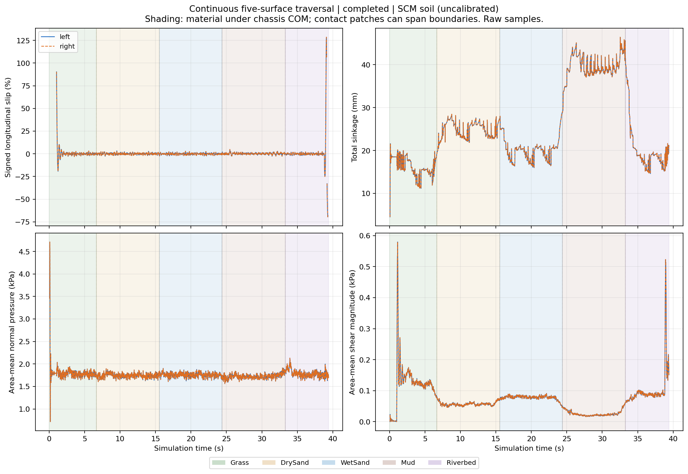
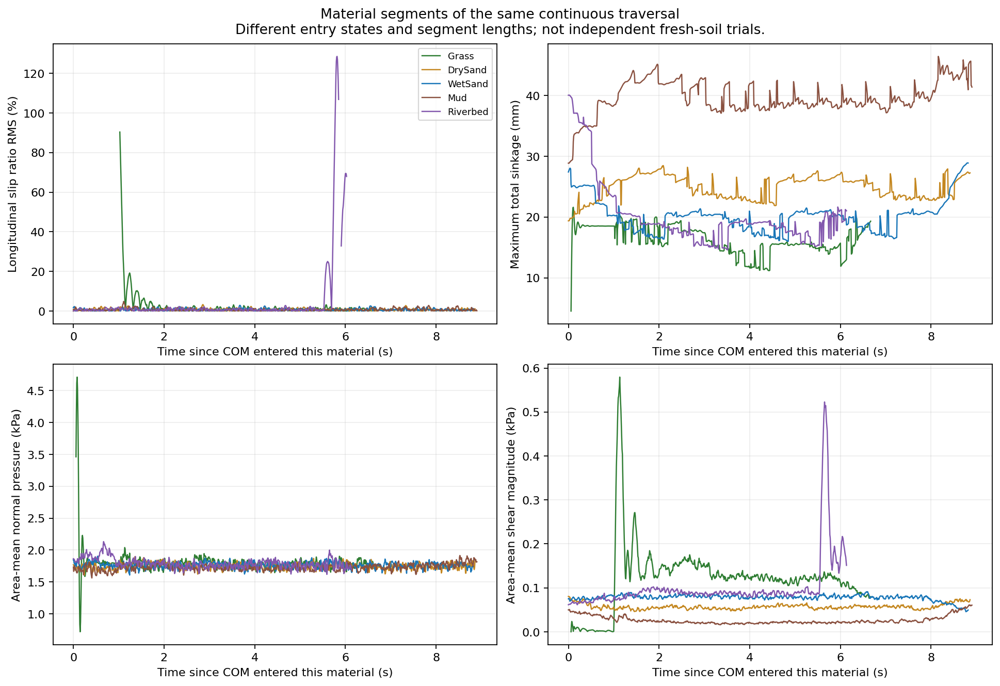
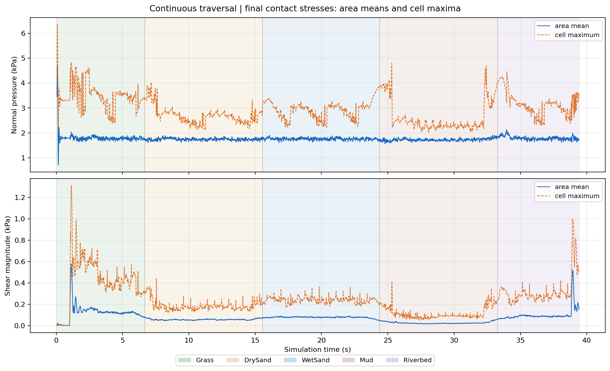
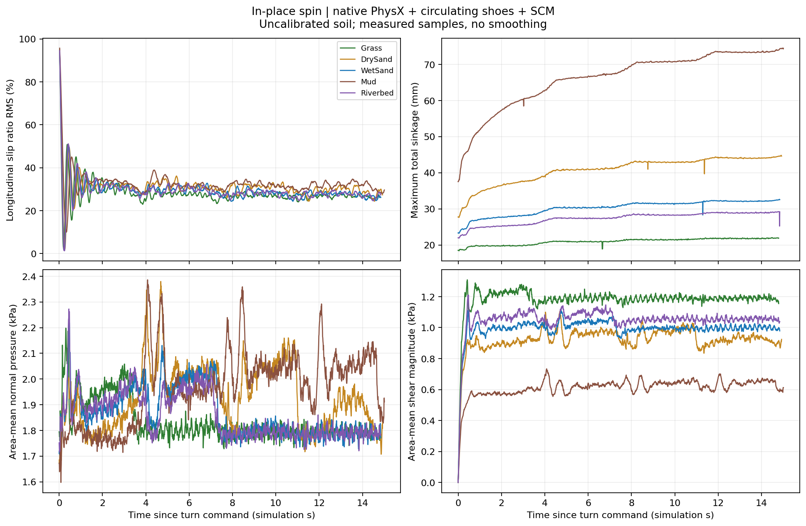
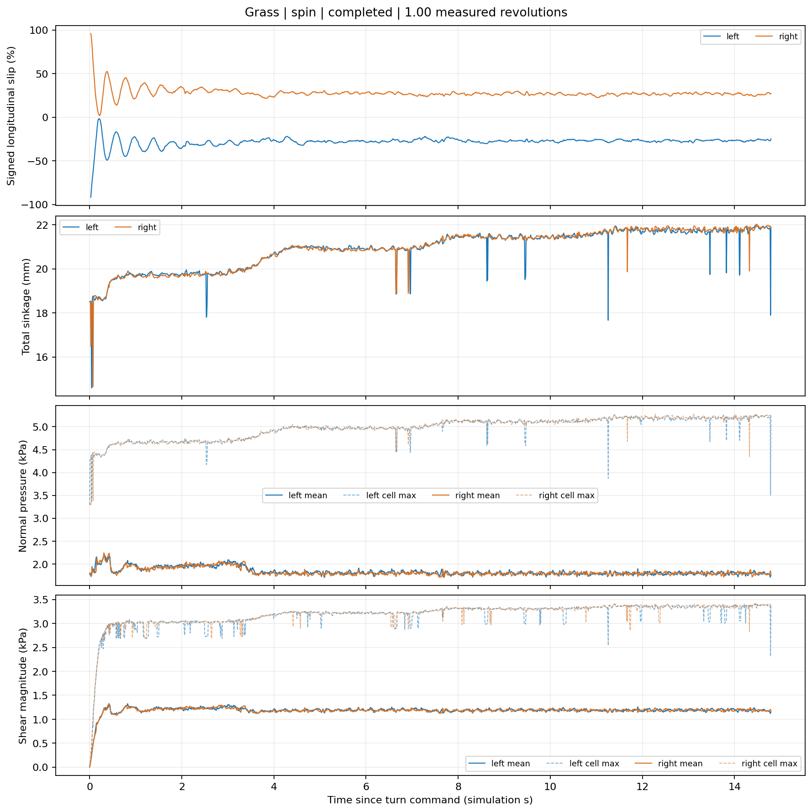
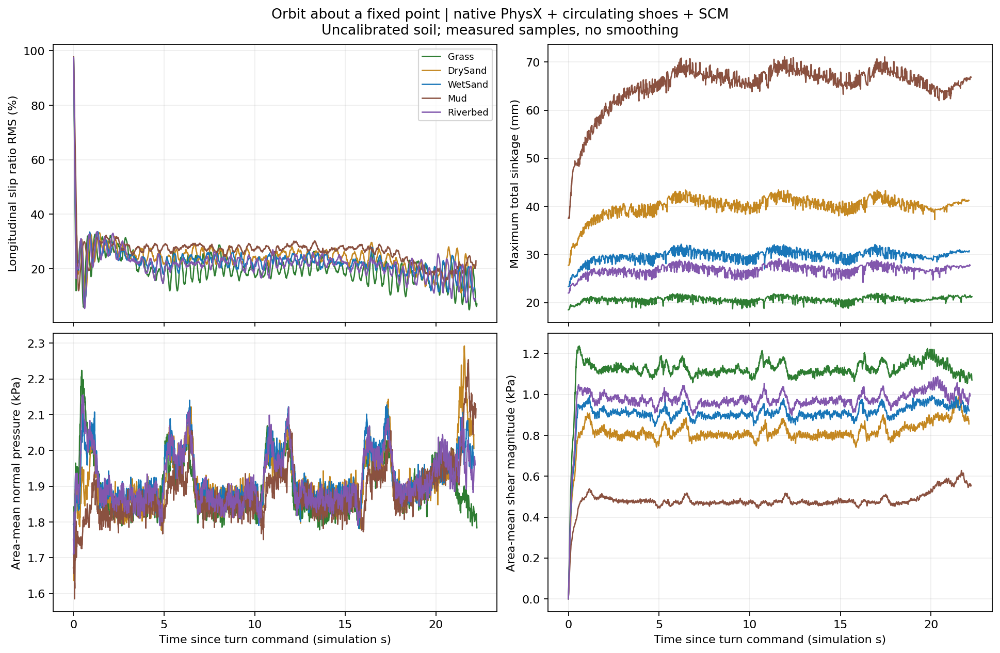
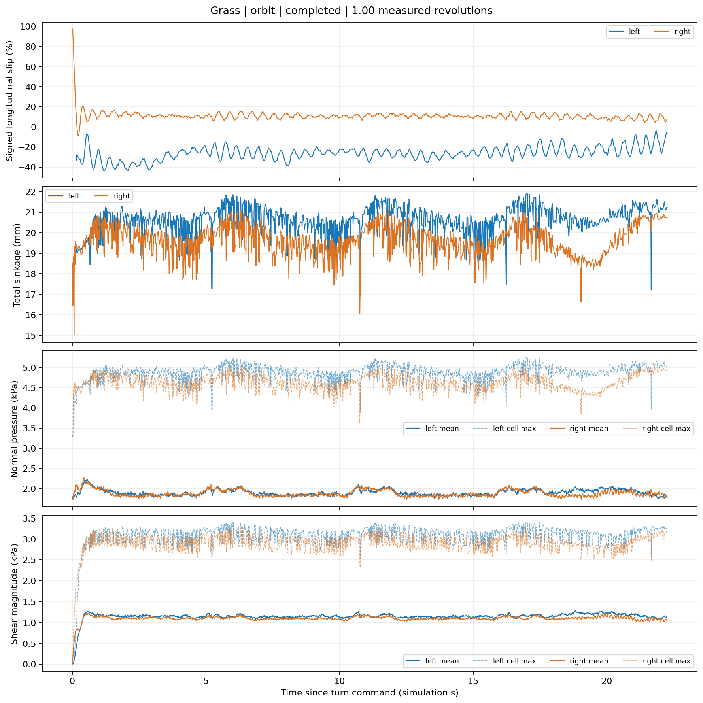
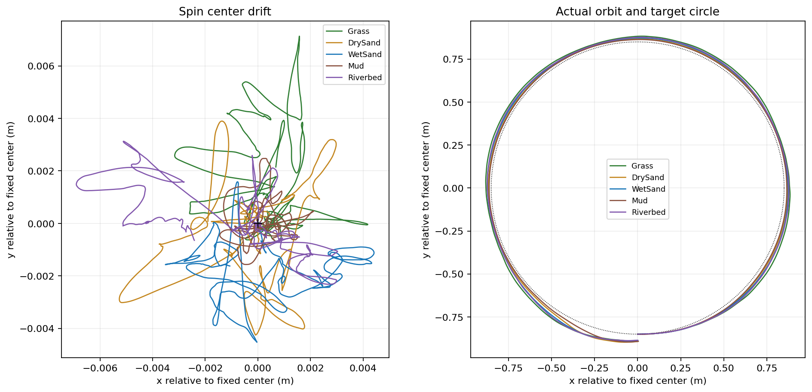

# 直线穿越、原地自转与绕点转动：实验折线图解读

本文解读 2026-11-01 已完成的原生 PhysX + 循环履带 + SCM 实验，围绕四个观测量展开：**滑移、总沉陷、法向压力、剪切应力**。图中数据来自实际保存的物理步记录，没有平滑或补零。

这组结果反映的是**当前未标定参数和当前控制器下的仿真行为**。草地、干沙、湿沙、泥地、河床是五套实验参数的名称，不能直接视为对真实同名土壤性能的实测结论。

阅读时先把三个问题分开：

- **承载问题**：车重相同，土壤需要以多大沉陷和什么压力分布提供支持？
- **剪切问题**：履带相对土壤怎样运动，产生了多大的局部剪切应力？
- **整车运动问题**：这些有方向的力相加后，产生的是前进、转动，还是相互抵消？

## 1. 数据来源、试验条件与统计范围

### 1.1 使用了哪几次记录

| 项目 | 直线穿越 | 原地自转 | 绕点转动 |
|---|---|---|---|
| 试验组织 | 一次连续穿过五块地面 | 每种地面独立一次 | 每种地面独立一次 |
| 记录来源 | `results/five_surfaces/run_20261101_132512_924339` | `results/turning/run_20261101_123133_262831` 中的 `*_spin.csv` | 同一目录中的 `*_orbit.csv` |
| 控制目标 | 沿 +X，带速约 0.45 m/s，终点停车 | 逆时针一圈，目标偏航角速度 0.45 rad/s | 绕固定圆心逆时针一圈，目标半径 0.85 m、前进速度 0.25 m/s |
| 起始静置 | 自动控制前约 1 s | 2 s，图中排除这段 | 2 s，图中排除这段 |
| 土壤历史 | 开始时清空，跨地形时不重置 | 每次清空 | 每次清空 |
| 完成时间 | 39.417 s，含落地、起步和停车 | 转动阶段约 14.79～15.01 s | 转动阶段约 22.09～22.26 s |
| 完成判据 | 质心到达目标 X 后减速停车 | 实际累计车身偏航角达到一圈 | 实际相对固定圆心的极角累计达到一圈 |

共同条件：整车质量 48 kg，重力 9.81 m/s²，物理采样 120 Hz，SCM 网格间距 0.02 m；每侧 48 块履带板，使用简化传动，没有独立链节和悬架动力学。

本组三种试验均为陆地工况；“河床”是第五套地面材料，不包含水体，推进器关闭。

直线试验共记录 **4730 个物理步**；十次转圈试验共记录 **24638 个物理步**，每次都完成了一圈。完整应用和无视口批处理在验证时，对选定的物理字段给出相同记录，详见[直行验证](straight_validation_20261101.json)与[转圈验证](turning_validation_20261101.json)。这说明两条入口的计算一致，**不等于模型已经通过实物精度验证**。

### 1.2 原图、表格的时间范围不同

**本文图片保留原始绘图范围**：直线图包含落地、起步、跨界和停车；转圈图从静置结束开始，仍包含转动起步瞬态。

转圈达到一圈时即暂停，没有采集完整的后续制动段。因此，不能把转圈图末端的波动自动等同于直线试验的停车峰。

为比较较持续的运动状态，本文表格另外选取了以下窗口：

| 表格统计 | 选取条件 | 用途与限制 |
|---|---|---|
| 直线“内部行驶窗口” | 仿真时间 ≥3 s；质心距当前材质两端 X 边界均 ≥0.7 m；左右带速指令均 >0.4 m/s；水平车速 >0.2 m/s | 减少起步、停车及混合材质接触的影响；各地面的窗口长度仍不同 |
| 自转、绕点“转动 3 s 后” | `turn_phase == turn` 且 `turn_time_s >= 3`，直到完成一圈 | 排除主要起步过程；不代表此后完全达到稳态，尤其泥地自转仍在继续下沉 |

表中均值是有效样本的时间均值；采样间隔固定约为 1/120 s，因此使用算术平均。NaN 不参与均值，**不能当零计算**。

不同窗口的均值不能直接混用。例如转圈验证 JSON 中的 `mean_sinkage_mm` 使用整个转动阶段，本文后段表格排除了前 3 s，数值会略有差别。精确窗口、样本数和未四舍五入的结果保存在[分析数据](images/experiment_curves_20261101/analysis_data.json)。

## 2. 四类曲线实际表示什么

### 2.1 滑移率：单侧曲线保留正负，对比曲线使用 RMS

当前单侧履带的纵向滑移率为：

$$
s_s=
\frac{-\sum_{i\in s}w_i(\mathbf v_{\mathrm{rel},i}\cdot\mathbf e_f)}
{\max(|u_s|,|\overline v_{\mathrm{body},x,s}|,0.05)},
\qquad
w_i=\frac{N_i}{\sum_{i\in s}N_i}.
$$

其中，\(\mathbf v_{\mathrm{rel},i}\) 是实际履带板材料点对土壤的水平相对速度，\(\mathbf e_f\) 是车体水平前向，\(u_s\) 是滤波后的带速。分子先在单侧接触区域内按法向载荷加权。

水平下段直线接触可近似理解为：

$$
s_s\approx\frac{u_s-v_{\mathrm{patch},x,s}}
{\max(|u_s|,|v_{\mathrm{patch},x,s}|,0.05)}.
$$

弧段接触还包含履带板的平移和转动，实际计算不能处处简化为这个标量速度差。

- **正值**：按车体前向约定，材料点的接触平均相对速度指向后方。
- **负值**：该平均相对速度指向前方；在倒车、自转和内侧履带制动时都可能出现。
- **接近零**：侧平均纵向相对速度较小，不保证每个局部点都无滑移，也不保证没有横向擦滑。
- **超过 100%**：这个有符号诊断定义允许出现，尤其当带速和车身局部速度方向相反时；不能直接称为数值越界。

单次试验图画出左右有符号曲线；五地面对比图以及直线分段对比图使用：

$$
S_{\mathrm{RMS}}=
\sqrt{\frac{N_Ls_L^2+N_Rs_R^2}{N_L+N_R}}\times100\%.
$$

仅有效侧参与求和。这样，自转时的 \(-30\%\) 和 \(+30\%\) 不会被平均成零。**这仍是左右“单侧平均滑移率”的 RMS，不是所有接触单元局部滑移的 RMS。**

低速或法向载荷不足时滑移率无效，图中留断点。不能把断点读成“完全不滑”。

### 2.2 总沉陷：当前最深接触位置，不是永久车辙

每侧总沉陷取压缩接触单元中，相对初始地面的最大下压：

$$
\delta_s=\max_{i\in s}(h_0-z_{\mathrm{contact},i}),
\qquad
\delta_{\mathrm{plot}}=\max(\delta_L,\delta_R).
$$

它包含土壤弹性压缩和已有塑性沉陷的共同影响。卸载后的永久车辙由另一个变量 \(z_p\) 记录。

因此，“平均总沉陷 40 mm”在本文是**各时刻最大总沉陷的时间平均**，不是接触区域平均深度，也不是挖走了 40 mm 厚的土。某个采样点退出接触，最大值就可能突然变化，整车质心不一定发生同等幅度的跳动。

### 2.3 压力：按接触面积平均，受整车支承需求约束

$$
\overline p(t)=\frac{\sum_i p_iA_i}{\sum_iA_i},
\qquad
p_{\max}(t)=\max_i p_i.
$$

这里是加入法向速度阻尼并截断负压力后的实际压力。图中均用 kPa，CSV 用 Pa；1 kPa=1000 Pa。

法向支持力满足逐步恒等式：

$$
N(t)=\overline p(t)A_{\mathrm{contact}}(t).
$$

在竖向加速度较小的阶段：

$$
N\approx mg=470.88\ \mathrm N.
$$

所以，车重相同、有效接触面积相近时，五种地面的**平均压力可能很接近**；柔软程度的区别更多体现为达到这一支承状态所需的沉陷深度。

注意，上式对每一时刻成立；一般不能把两个时间均值相乘，严格替代 \(\langle N\rangle\)。

### 2.4 剪切应力：先取局部模长，再按面积平均

$$
\overline\tau(t)=\frac{\sum_i\|\boldsymbol\tau_i\|A_i}{\sum_iA_i},
\qquad
\tau_{\max,\mathrm{cell}}(t)=\max_i\|\boldsymbol\tau_i\|.
$$

\(\boldsymbol\tau_i\) 包含纵向和横向分量，是经过速度阻尼及二维强度限幅后的最终应力。它与图中“滑移率”只描述纵向平均量的范围不同。

这个统计不会让左右、前后方向相反的剪切相互抵消。但整车合力需要按方向相加：

$$
\mathbf F_t=\sum_i\boldsymbol\tau_iA_i,
\qquad
M_z=\sum_i(x_iF_{y,i}-y_iF_{x,i}).
$$

因此，**剪切应力均值大，不保证净前向牵引力大**；它也可能主要在产生驱动转矩、抵抗横向擦滑，或在不同位置相互抵消。

## 3. 实验一：直线穿越五种地形

### 3.1 先按时间识别阶段



**图 1：** 左上为左右有符号滑移率，右上为两侧总沉陷，左下为两侧平均压力，右下为两侧平均剪切应力。左右曲线高度重合，与当前对称整车、平地和直行控制条件一致。颜色背景表示**质心**所在的材质，不是整个履带覆盖区域的唯一材质。

| 质心所在材质 | 对应时间 / s | 曲线应重点观察什么 |
|---|---:|---|
| 草地 Grass | 0.008～6.683 | 落地冲击、约 1 s 开始驱动、起步收敛 |
| 干沙 DrySand | 6.683～15.550 | 沉陷增大；后段平均压力仍接近支承所需水平 |
| 湿沙 WetSand | 15.550～24.375 | 沉陷较干沙减小，接触状态逐步过渡 |
| 泥地 Mud | 24.375～33.283 | 五段中最深的总沉陷，但剪切应力均值最低 |
| 河床 Riverbed | 33.283～39.417 | 沉陷减小，末尾出现停车瞬态 |

履带有前后长度：前部会在质心越界前先接触新地形，后部在质心越界后仍可能留在旧地形。因此，**竖线前后出现平缓过渡或尖峰，不能仅凭位置就认定材质识别延迟。**

### 3.2 起步和停车的大滑移峰值，不能当作持续行驶滑移

CSV 可以把几个显著峰值区分开：

| 事件 | 时刻 / s | 实际记录 | 解读 |
|---|---:|---|---|
| 初始落地 | 0.092 | 平均压力约 4.712 kPa，局部峰值约 6.343 kPa，竖直速度约 −0.413 m/s；驱动指令为零 | 是接触建立和竖向动态响应，不是开始牵引导致的压力峰 |
| 起步滑移峰 | 1.033 | 带速约 0.069 m/s，车体接触区纵向速度约 0.007 m/s，左右滑移率约 +90.37% | 带速建立早于车身速度，短时相对运动大 |
| 停车滑移峰 | 39.100 | 指令已为零，但带速仍约 +0.064 m/s；车体接触区纵向速度约 −0.018 m/s；左右滑移率约 +128.53% | 滤波传动尚未停止，车体速度已短暂反向，分子大于分母 |

停车峰值附近，实际车身质心纵向速度约为 −0.022 m/s。带速与局部车体速度方向相反，可以自然产生超过 100% 的诊断值；这不是持续以 128% 滑移率行驶。其后还有低速振荡与无效滑移样本，需要同时看带速、车速和有效性标记。

全程滑移图的纵轴被起步、停车峰值拉宽，持续行驶时的细小起伏在视觉上接近零。不要只按整幅图的高度判断持续滑移大小。

### 3.3 地形内部行驶时，差异主要出现在沉陷和剪切应力

按第 1.2 节的“内部行驶窗口”重新统计：

| 地形 | 统计时间 / s | 滑移 RMS 均值 / % | 总沉陷均值 / mm | 平均压力 / kPa | 平均剪切应力 / kPa |
|---|---:|---:|---:|---:|---:|
| 草地 | 3.000～5.133 | 0.85 | 14.38 | 1.775 | 0.124 |
| 干沙 | 8.242～13.983 | 0.71 | 25.23 | 1.750 | 0.056 |
| 湿沙 | 17.092～22.825 | 0.73 | 19.06 | 1.762 | 0.080 |
| 泥地 | 25.942～31.708 | 0.65 | 39.65 | 1.724 | 0.022 |
| 河床 | 34.817～38.808 | 0.70 | 17.71 | 1.767 | 0.089 |

**沉陷排序**为：泥地 > 干沙 > 湿沙 > 河床 > 草地。这与当前法向参数的差异一致：五种材料的 \(n\) 都为 1.1、\(k_c\) 都为零，而泥地的 \(k_\phi\) 最低，草地最高。

**平均压力仅在约 1.72～1.78 kPa 之间变化**，并不表示五种材料同样硬。各窗口的平均支持力都约为 470.9 N，平均接触面积约为 0.265～0.273 m²。相近的载荷和面积，使平均压力接近；更软的材料通过更深的压沉参与承载。

**泥地的纵向滑移 RMS 并非最大**，而且剪切应力均值较低。这一次直行试验没有挂牵引负载，后段车速约 0.45 m/s，所需净前向力较小。低抗剪强度的材料在低牵引需求下仍可能维持低纵向滑移。不能把这张表解释成“泥地牵引性能最好”，也不能据此推断各地形的最大牵引能力。

表中的 RMS 只表示有符号滑移率的大小；实际左右曲线会在零附近正负变化，不能把正的 RMS 均值读成始终正向驱动打滑。

### 3.4 分段叠加图怎样比较



**图 2：** 横轴在每次质心进入对应材质时归零，因此草地的起步峰和河床的停车峰会被移动到各自区段内。图中没有重置车辆或土壤，也没有人为把各段缩放为同样长度。

这张图适合快速看各段的沉陷量级、应力水平和过渡过程。它不适合直接把整段均值当作材料的独立对照：草地含起步，河床含停车，中间材料的进入速度、姿态和前一段接触历史也不同。需要比较内部行驶状态时，应使用上面的窗口表。

### 3.5 单元峰值比面积均值更敏感



**图 3：** 蓝线是当前接触区域的面积加权均值，橙色虚线是某一接触单元的最大值。两者空间统计不同。

法向压力均值在持续行驶阶段相对平稳，单元峰值却有明显起伏。这说明整车支承可以稳定，同时局部压力分布持续变化。履齿与板底交替参与接触、姿态变化、跨材质接触以及固定网格采样，都可能影响局部极值。

剪切应力在起步和停车时的峰值也明显高于持续行驶水平，说明这些瞬态会集中动员局部抗剪能力。**不能用一个单元的峰值乘整个履带面积估计总牵引力。**

目前没有对网格间距、时间步和履带块数量进行这一组曲线的敏感性对照，不能把每个细小尖峰都认定为已经验证的真实履齿冲击。

## 4. 实验二：原地自转

### 4.1 为什么车身几乎不前进，滑移和剪切仍然很大



**图 4：** 横轴从静置结束开始，不含此前 2 s 落地阶段。第一瞬间已有法向压力和沉陷，剪切应力则随着带速及剪切记忆建立而增长。

逆时针自转时，左带后转、右带前转。局部接触点的车体速度包含旋转项：

$$
v_x=-\Omega y,\qquad v_y=\Omega x.
$$

前部和后部横向擦滑方向相反。它们的横向合力可能很小，但产生的阻力矩会叠加。左右履带必须建立纵向反力差，提供驱动转矩：

$$
M_{z,\mathrm{drive}}\approx\frac d2(F_{x,R}-F_{x,L}),\qquad d=0.7\ \mathrm m.
$$

所以，质心位置基本不变并不表示没有履土相对运动。后段的横向滑移 RMS 约为 **0.112～0.118 m/s**，是直线行驶中基本没有的擦滑需求。

### 4.2 起步振荡后仍有约 27%～32% 的纵向滑移 RMS

自转图左上角开始时接近 100%，随后经过振荡，进入较持续的转动状态。带速响应、整车转动惯量、剪切记忆与反馈控制同时参与这个过程，不能把起步波形全部归结为某一个土壤参数。

转动 3 s 后的统计为：

| 地形 | 滑移 RMS 均值 / % | 总沉陷均值 / mm | 平均压力 / kPa | 平均剪切应力 / kPa | 完成时总沉陷 / mm |
|---|---:|---:|---:|---:|---:|
| 草地 | 27.00 | 21.31 | 1.803 | 1.188 | 21.89 |
| 干沙 | 30.27 | 42.27 | 1.957 | 0.943 | 44.61 |
| 湿沙 | 28.47 | 31.11 | 1.859 | 1.005 | 32.55 |
| 泥地 | 31.79 | 69.40 | 2.017 | 0.630 | 74.46 |
| 河床 | 28.29 | 28.03 | 1.841 | 1.061 | 29.17 |

在当前配置下，泥地同时呈现较高滑移、较深沉陷和较低剪切应力；草地的沉陷较浅、剪切应力较高。这与两类能力同时有关：法向承载决定下沉量，抗剪强度限制水平反力。

不能只说“泥地沉得深，所以剪切力更大”。当前强度上限为：

$$
\tau_{\mathrm{limit}}=c+p\tan\phi.
$$

泥地的内摩擦角为 18°，草地为 32°；在相近法向压力下，泥地的强度上限较低。剪切位移继续增加时，应力也不能无限增长。

### 4.3 自转中沉陷继续增长，不能直接称为已经实现了“刨坑”

右上角泥地曲线从转动初期约 38 mm 增至完成时约 74 mm，干沙也有明显增长。其他材料的增长较小。

当前代码保留塑性沉陷，移动的履带板和履齿不断改变覆盖单元及接触高度，车辆也会调整竖向位置和姿态。**局部重新加载、接触集合变化以及车体动态沉降**可以共同形成这种曲线。其增长不是一个额外指定的“自转下陷速度”。

但本模型没有土体体积流动、剪切诱发挖掘或土壤密度硬化状态，也没有单独的静载蠕变律。若同一单元保持相同几何压缩状态，不能仅因时间增加就宣称它会持续蠕变。图中现象最多说明当前模型形成了继续下沉和残余变形，不能据此声称真实土壤的自转掘土机理已经被完整模拟。

以泥地自转的完成样本为例：当前最大总沉陷约 74.46 mm，当前接触区最大永久沉陷约 66.82 mm。这是两个不同字段的最大值，也未必来自同一个单元，**不能直接把它们的差当成某个具体单元的弹性压缩量**。

### 4.4 左右滑移一正一负，是这次自转的正常方向关系



**图 5：** 左带滑移约为负值，右带约为正值；上面的五地面对比图采用 RMS，因此对应为正的综合量。左右沉陷和压力曲线很接近，不能据此要求滑移也同号。

草地自转 3 s 后的平均纵向反力约为：

$$
F_{x,L}=-76.13\ \mathrm N,
\qquad F_{x,R}=+76.14\ \mathrm N.
$$

两侧净前向力接近零，但纵向反力差对应的近似驱动转矩约为：

$$
\frac{0.7}{2}[76.14-(-76.13)]\approx53.3\ \mathrm{N\,m}.
$$

这不是整车净加速转矩。横向擦滑会产生反向力矩，代码最终按全部单元的 \(\mathbf r\times\mathbf F\) 求和。当前记录没有把驱动项和横向阻力矩单独拆开输出。

草地后段平均剪切应力约为 1.188 kPa，而净前向牵引约为 0.006 N。这组数值直接说明：**剪切模长的面积均值不能替代有方向的整车合力。**

压力方面也不应把泥地约 2.017 kPa 直接解释成“承载更硬”。后段泥地自转的平均接触面积约为 0.234 m²，草地约为 0.261 m²，而两者平均支持力都约 470.9 N。较小的有效接触面积会提高平均压力，已有塑性历史也使压力不再只由首次加载包络决定。

## 5. 实验三：绕固定点转动

### 5.1 绕点图的滑移低于本次自转图，但仍远高于直行



**图 6：** 每次都以所在材质区域中心为固定圆心，目标半径 0.85 m。图中仍保留驱动起步瞬态，不含之前 2 s 静置。

转动 3 s 后的统计：

| 地形 | 滑移 RMS 均值 / % | 总沉陷均值 / mm | 平均压力 / kPa | 平均剪切应力 / kPa | 完成时总沉陷 / mm |
|---|---:|---:|---:|---:|---:|
| 草地 | 19.17 | 20.72 | 1.888 | 1.125 | 21.23 |
| 干沙 | 23.41 | 40.56 | 1.924 | 0.821 | 41.24 |
| 湿沙 | 21.61 | 29.97 | 1.923 | 0.914 | 30.75 |
| 泥地 | 25.87 | 66.53 | 1.893 | 0.486 | 66.83 |
| 河床 | 20.83 | 27.01 | 1.917 | 0.977 | 27.73 |

相比本次自转，绕点试验的后段滑移和平均剪切应力均较低，横向滑移 RMS 也降至约 **0.082 m/s**。但两次试验的运动条件不同：自转后段实际偏航角速度约 0.43 rad/s，绕点约 0.29 rad/s，绕点还包含前进运动。

因此，这里可以得出“**在本次控制目标下，绕点试验的擦滑指标低于原地自转**”，不能进一步说“只要绕点就一定更省能”，也不能把差异全部归结为半径。要隔离半径的影响，需要在相同角速度或相同运动学约束下另做对照。

### 5.2 两条履带都向前转，为什么内侧仍是负滑移



**图 7：** 逆时针左转时，左带为内侧、右带为外侧。内侧滑移明显为负，外侧为正，不能把内侧负滑移误读为“履带正在倒转”。

草地转动 3 s 后的平均记录如下：

| 工况与侧别 | 滤波带速 / m/s | 车体接触区纵向速度 / m/s | 有符号滑移率均值 / % | 纵向土壤反力 / N |
|---|---:|---:|---:|---:|
| 自转，左带 | −0.207 | −0.152 | −27.09 | −76.13 |
| 自转，右带 | +0.208 | +0.153 | +26.87 | +76.14 |
| 绕点，左带 | +0.111 | +0.149 | −25.00 | −77.31 |
| 绕点，右带 | +0.389 | +0.351 | +10.37 | +77.69 |

绕点时内侧带速虽然为正，但低于对应车体接触区的前向速度，因此相对土壤表现为前向擦滑、受到后向反力，承担了制动和维持转矩差的作用。外侧反之。

单侧带速、平均车体速度和平均滑移率来自不同的逐步加权过程，加上弧段材料点速度项，不应要求直接用表中三个时间均值代入简化公式就精确相等。应以逐物理步计算为准。

这也解释了综合 RMS 的作用：它保留内外侧滑移的大小，不能替代带符号的左右曲线；后者才能判断内侧是在驱动还是制动。

### 5.3 沉陷与压力波动不等于车身正在上下剧烈跳动

绕点时，两条履带走过不同的圆环，接触单元持续更换；车身方向相对固定网格不断变化，履带板和履齿也持续循环。局部最大沉陷及单元应力峰值因此可能出现尖锐的采样变化。

图 7 中局部最大值的尖峰明显多于平均压力的起伏。解释时应同时看 `z_m`、俯仰/横滚、接触面积及接触单元数，不能把最大采样值的每次突变都解释成同样幅度的整车跳跃。

结合代码，周期性起伏可能同时包含履带接触几何、网格方向和反馈控制的影响。本次没有进行因素隔离试验，因此不能仅凭相似周期就指定为“某个轮子”或“某种真实土壤振动”的频率。

### 5.4 实际轨迹证明完成了绕点，但圆并非被强制约束



**图 8：** 左图的尺度是毫米级漂移，右图是约 0.85 m 半径的运动。两图独立缩放，不能凭图形尺寸比较两种运动的位移量。

| 地形 | 原地自转最大质心偏离 / mm | 绕点最大半径误差 / mm |
|---|---:|---:|
| 草地 | 7.30 | 58.85 |
| 干沙 | 6.03 | 57.29 |
| 湿沙 | 4.58 | 56.21 |
| 泥地 | 2.49 | 48.70 |
| 河床 | 7.06 | 56.82 |

右图虚线是目标圆，实际轨迹总体稍偏外。控制器只输出左右带速，不会把车辆位置投影到理想圆上，因此会留下路径误差。这是需要报告的控制结果，而不是要隐藏或修成完美圆的数据。

绕点完成判据使用相对指定圆心的累计极角，不是只看车头朝向转了一圈。十次试验都完成了各自定义的一圈；表中的最大误差则说明“完成一圈”和“精确跟踪目标轨迹”是两种不同指标。

## 6. 三种工况放在一起，可以得到什么结论

### 6.1 本次转动工况比直行产生了更大的沉陷

| 地形 | 直线内部窗口总沉陷 / mm | 自转 3 s 后总沉陷 / mm | 绕点 3 s 后总沉陷 / mm |
|---|---:|---:|---:|
| 草地 | 14.38 | 21.31 | 20.72 |
| 干沙 | 25.23 | 42.27 | 40.56 |
| 湿沙 | 19.06 | 31.11 | 29.97 |
| 泥地 | 39.65 | 69.40 | 66.53 |
| 河床 | 17.71 | 28.03 | 27.01 |

这些是不同窗口内“瞬时最大总沉陷”的时间均值。当前试验中，三种工况的地形排序一致；原地自转的总沉陷最深，绕点次之，直线较浅。

这一观察与转动时的横向擦滑、不同接触覆盖及重复加载历史相容，但**不是只改变一个因素得到的因果对照**：直线、原地和绕点的带速、角速度、空间路径、接触历史及持续时间均不同。

### 6.2 低滑移、高剪切和高牵引能力是不同概念

| 容易混淆的读法 | 本次数据支持的解释 |
|---|---|
| 泥地直线滑移略小，所以通过性最好 | 本次为低牵引需求的连续直行；泥地实际沉陷最大，且没有测试极限牵引载荷 |
| 转圈剪切均值比直行高，所以净前向力也大 | 转圈存在大量方向相反的反力，主要需要建立转矩并抵抗擦滑 |
| 五种地面压力相近，所以软硬相同 | 固定车重和相近接触面积限制了平均压力范围；沉陷量和分布仍明显不同 |
| 总沉陷持续增大，说明已经模拟了真实挖土和蠕变 | 当前包含塑性历史和动态接触，但没有完整挖掘、土体流动或蠕变模型 |
| 一圈完成，说明控制没有误差 | 原地仍有毫米级漂移，绕点仍有厘米级半径误差 |
| 曲线重复且两条入口一致，说明实物精度已达标 | 这是实现一致性证据；仍需要实物标定、独立验证和数值收敛检查 |

### 6.3 应力强度关系能解释趋势，但不能单靠曲线反算所有参数

当前响应主要受以下关系控制：

$$
p_B=\left(\frac{k_c}{b}+k_\phi\right)\delta^n,
\qquad
\tau_{\mathrm{limit}}=c+p\tan\phi,
\qquad
\tau_{JH}=\tau_{\mathrm{limit}}(1-e^{-\|\mathbf j\|/K}).
$$

实际求解还包括弹性卸载、法向阻尼、二维剪切方向、切向阻尼及最终强度限幅。当前五种地面共同使用 \(k_e=600000\ \mathrm{Pa/m}\)、\(R_n=5000\ \mathrm{Pa\,s/m}\)、\(C_t=1000\ \mathrm{Pa\,s/m}\)。

这些参数、接触面积和控制器会共同影响曲线。不能只由一条沉陷或滑移曲线，唯一确定整套土壤参数；也不能把参数分区名称当作材料标定来源。模型和参数的完整定义见[履带结构与履土交互动力学详解](track_soil_dynamics.md)。

## 7. 当前结果的适用范围

这组图适合检查：各材质承载差异是否进入运动结果；起步、停车与差速转向是否产生合理方向的反力；土壤历史是否被保留；控制器能否完成路线；输出指标是否使用了正确的单位与统计方式。

用于进一步定量评价时，还缺少以下证据：

1. **实物参数标定**：压板加载—卸载、剪切试验，以及独立的整车牵引和转向试验。
2. **数值敏感性**：网格间距、物理时间步、接触采样和履带块数量变化后的结果比较。
3. **控制条件对齐**：相同角速度、相同载荷或相同路径条件下的工况对照，减少控制器与目标速度的混杂影响。
4. **重复性与不确定性**：当前每种转动工况每种材质只有一次试验，没有多次独立样本或置信区间。
5. **更完整的土体与传动模型**：目前没有三维体积流动、孔压、完整履齿侧壁被动土压力，以及电机负载转矩反馈。

本组转圈验证的完整应用与无视口批处理曾同时运行，RTF 不适合作为单独运行的性能基准。应力和滑移图也不是完整能量账本，不能据此直接报告电机能耗或牵引效率。

## 8. 图表、统计数据与复现

### 8.1 文档图片已独立保存

本文八张图片复制自对应试验的原始 PNG，位于 `docs/images/experiment_curves_20261101/`。没有修改原始图像，也没有重新生成模拟数据。

原始运行结果位于被 Git 忽略的 `results/`；本文的图片和[分析数据 JSON](images/experiment_curves_20261101/analysis_data.json)位于 `docs/`，可与文档一起纳入版本管理。分析数据保存了 11 份 CSV 和八张图的 SHA-256、窗口定义、样本数、统计结果及瞬态样本，便于核对。

### 8.2 从已有记录重新计算本文表格

在项目目录执行：

```bash
cd /home/touxinboy/HUST/isaacsim/ground/five_surfaces
python3 docs/figures/analyze_experiment_curves.py
```

默认读取第 1.1 节指定的历史运行目录。也可指定其他记录与新的输出目录：

```bash
python3 docs/figures/analyze_experiment_curves.py \
  --straight results/five_surfaces/run_实际时间戳 \
  --turning results/turning/run_实际时间戳 \
  --output docs/images/新分析目录
```

脚本只读取 CSV、计算统计和复制原图，不启动仿真、不平滑曲线。对新试验重新运行后，应同步更新本文时间区间、表格和解读；不能把旧文字直接作为新试验结论。

### 8.3 实现与验证入口

- [直行绘图验证记录](straight_validation_20261101.json)、[转圈验证记录](turning_validation_20261101.json)：完成状态与入口一致性检查。
- [SCM 受力计算](../scripts/scm_terrain.py)：压力、剪切、沉陷及统计字段的实际来源。
- [车辆运行时](../scripts/ground_runtime.py)：直线控制、终点减速与记录时序。
- [转圈控制器与指标定义](../scripts/turning_experiments.py)：自转、绕点的控制及完成判据。
- [直行绘图](../scripts/plot_straight.py)、[转圈绘图](../scripts/plot_turning.py)：原图的时间轴、分段及曲线定义。
- [本文统计与图片归档脚本](figures/analyze_experiment_curves.py)：重新计算窗口统计并检查数据来源。
