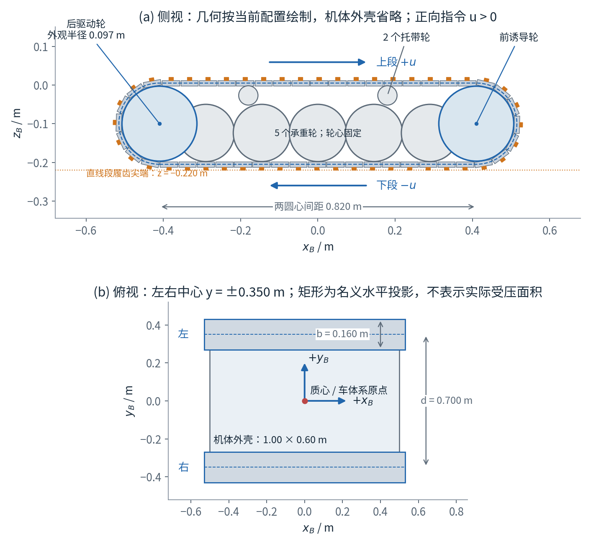
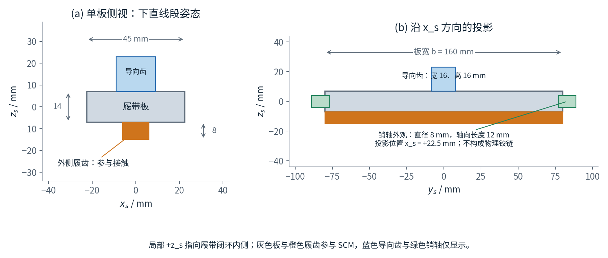
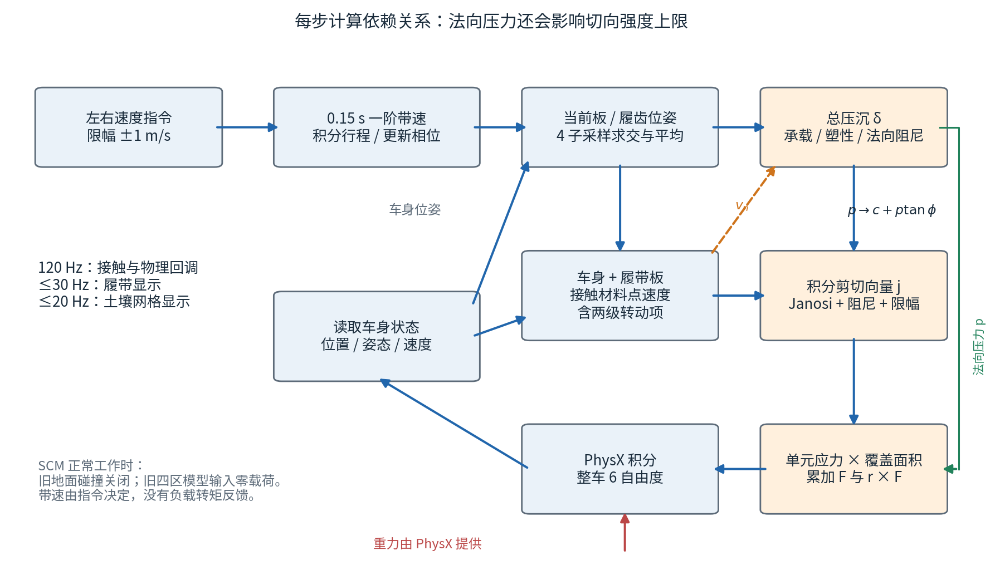
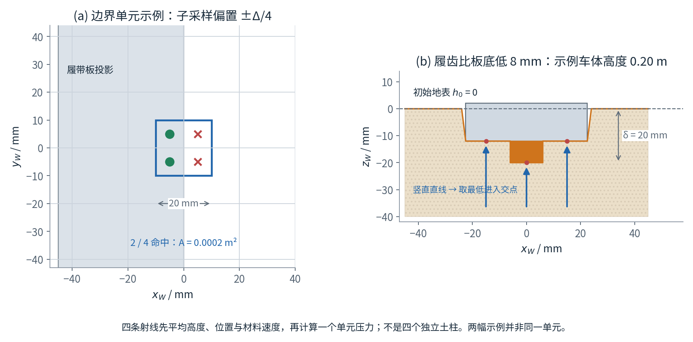
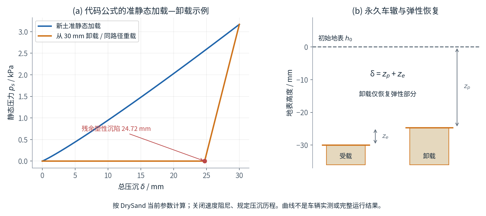
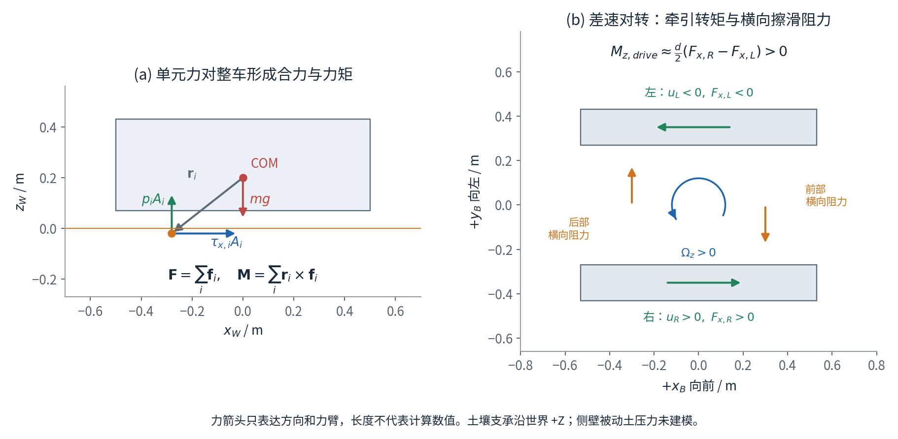
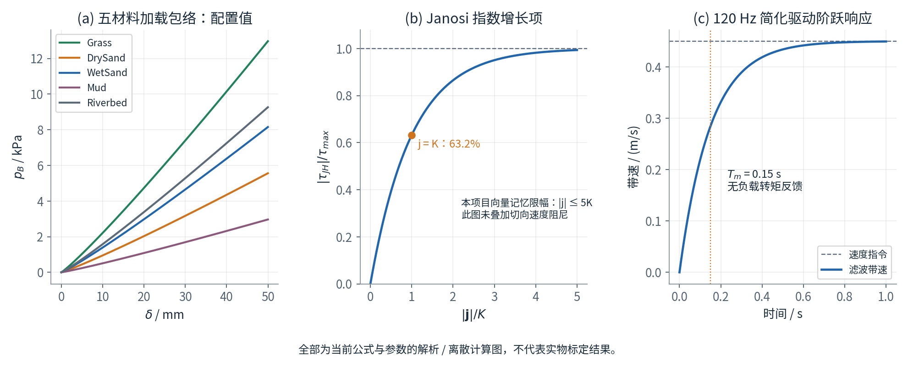

# 当前循环履带的结构、运动学与履土交互动力学

> 核对日期：2026-10-31。对象：`ground/five_surfaces` 工程默认的 **SCM + 循环履带** 模式。
> 本文依据现有配置和代码推导，不把设计意图当作已实现功能。全部示意图由配置、几何和公式绘制，并非 Isaac Sim 运行截图或实物试验结果。
> 参数尚未标定；新循环履带的原生场景画面、完整运行稳定性和 RTF 验证尚未完成。此前光滑履带 SCM 的运行记录不能直接作为新模型的验证结论。

## 阅读导航

1. [模型是什么、哪些部件真正参与动力学](#1-模型是什么哪些部件真正参与动力学)
2. [坐标系、符号与结构尺寸](#2-坐标系符号与结构尺寸)
3. [履带板如何沿闭环运动](#3-履带板如何沿闭环运动)
4. [接触区域和材料点速度如何计算](#4-接触区域和材料点速度如何计算)
5. [土壤法向承载、沉陷和卸载](#5-土壤法向承载沉陷和卸载)
6. [剪切、牵引与转向阻力](#6-剪切牵引与转向阻力)
7. [合力、力矩和整车运动](#7-合力力矩和整车运动)
8. [参数逐项解释与数值算例](#8-参数逐项解释与数值算例)
9. [滑移、沉陷、功率和 RTF 的记录含义](#9-滑移沉陷功率和-rtf-的记录含义)
10. [显示、模式切换与模型边界](#10-显示模式切换与模型边界)
11. [代码定位、复现和验证](#11-代码定位复现和验证)
12. [参考来源与公式归属](#12-参考来源与公式归属)

---

## 1. 模型是什么、哪些部件真正参与动力学

当前实现可以概括为：

**整车一个刚体 + 运动学规定的循环履带板 + 固定世界网格上的弹塑性土柱 + 接触力积分。**

履带板确实沿闭环移动，接触计算也使用移动后的履带板和履齿几何；但每块履带板没有独立的质量、惯量、速度求解或铰链约束。它属于面向实时交互的履带近似，不是完整多刚体链条。

| 部件或状态 | 当前构成 | 是否独立动力学自由度 | 是否向 SCM 提供接触 |
| --- | --- | --- | --- |
| 整车 `/World/Robot` | 48 kg 刚体，指定质心和惯量 | 是：三平动、三转动 | 接收全部履土合力和力矩 |
| 履带板 | 每侧 48 块，共 96 块 | 否，沿固定路径规定运动 | 是，定向长方体 |
| 外侧履齿 | 每块板 1 条横向履齿 | 否，随板运动 | 是，另一块定向长方体 |
| 导向齿 | 每块板内侧 1 个 | 否 | 否，仅显示 |
| 销轴 | 每块板两侧的圆柱外观 | 否，没有实际铰链 | 否，仅显示 |
| 承重轮 | 每侧 5 个 | 否，轮心固定，转角由带速推算 | 否 |
| 后驱动轮、前诱导轮 | 每侧各 1 个 | 否，没有齿轮啮合约束 | 否 |
| 托带轮 | 每侧 2 个 | 否 | 否 |
| 土壤 | 1000 × 300 个固定 XY 单元 | 不求解土体三维运动；更新单元内部状态 | 是，提供法向与切向应力 |

新增显示部件不会增加整车质量或改变惯量。承重轮不会通过悬架把载荷传到某几块板上；载荷分布由**整车姿态、板与齿的接触高度、土壤历史和本构关系**共同决定。

图 1 按配置尺寸绘制。侧视中的轮组表示其固定几何位置，不表示已经建立轮—板接触约束。



*图 1：侧视采用车体系 XZ 平面；俯视采用 XY 平面。橙色为履齿。机体外壳在侧视中省略，便于看到轮组。矢量版：[SVG](figures/01_track_geometry.svg)。*

### 1.1 “SCM 式”在本项目中的具体含义

DLR 的 SCM 思路将地面离散成高度网格，并以离散接触作用力连接刚体系统；Chrono 提供了自己的 SCM 实现。[R2](#r2) [R3](#r3)

本项目借鉴这种组织方式，但自行用 NumPy 实现：

- 使用密集数组保存整个地图，而非 Chrono 的受扰节点哈希表。
- 法向沿世界 Z，不随车辙斜坡法线旋转。
- Bekker 宽度固定为名义履带宽 0.16 m，没有计算连通接触区的 `2A/U` 等效宽度。
- 没有 DLR 文献中的中心度压力修正、土体迁移和侵蚀，也没有 Chrono 的完整推土模块。
- 向量剪切记忆、限幅、速度阻尼和下文的塑性更新均按本项目代码解释，不能直接称为原始文献算法。

## 2. 坐标系、符号与结构尺寸

### 2.1 三个坐标系

采用右手坐标系：

- **世界系 W**：`+Z` 向上，初始平地位于 `h₀ = 0`；地图长度沿世界 X。
- **车体系 B**：原点在整车指定质心；`+x_B` 向车头，`+y_B` 向左，`+z_B` 向上。
- **单板系 S**：原点在板中心；`+x_s` 沿路径正参数方向的切线，`+y_s` 与车体横向一致，`+z_s` 指向履带闭环内侧。

令：

$$
\mathbf x_W=\mathbf x_C+\mathbf R\,\mathbf x_B,\qquad
\mathbf x_B=\mathbf R^\mathsf T(\mathbf x_W-\mathbf x_C).
\tag{1}
$$

`R` 是由车体旋转四元数生成的 B→W 旋转矩阵，代码四元数顺序为 `(qx,qy,qz,qw)`。在下直线段，单板 S 的三个轴与车体 B 平行；到上段时，板转过约 180°，其外侧履齿自然朝上。

### 2.2 常用符号

| 符号 | 含义 | 单位 |
| --- | --- | --- |
| `m, I_B` | 整车质量、车体系惯量张量 | kg，kg·m² |
| `x_C, R, v_C, ω` | 质心位置、姿态、世界平动及角速度 | m，—，m/s，rad/s |
| `u_s, D_s, φ_s` | 第 s 侧滤波带速、累计行程、闭环相位 | m/s，m，m |
| `a, r_p, L_p, p_t` | 直线半长、路径半径、路径周长、板中心节距 | m |
| `θ, κ` | 路径切线角、曲率 | rad，1/m |
| `Δ, A_i` | 土壤网格间距、单元有效覆盖面积 | m，m² |
| `δ_i, z_{p,i}, z_{e,i}` | 总压沉、永久塑性沉陷、弹性下压 | m |
| `p_B, p_s, p_i` | Bekker 加载包络、静态压力、含阻尼的压力 | Pa |
| `j_i, K, τ_i` | XY 剪切位移向量、剪切变形长度、XY 剪应力向量 | m，m，Pa |
| `c, φ` | 剪切黏聚项、内摩擦角；与相位 `φ_s` 区分 | Pa，度 |

正文公式中的下标 `i` 表示土壤单元，下标 `s∈{L,R}` 表示左右侧，履带板编号用 `k`。代码中的 `z` 是这里的总压沉 `δ`，不是世界坐标 `z_W`。

### 2.3 整体尺寸和单板尺寸

配置来自 [robot_v1.json](../configs/robot_v1.json) 与 [tracks.json](../configs/tracks.json)。

| 项目 | 当前数值 | 说明 |
| --- | --- | --- |
| 名义履带外廓长 `L` | 1.060 m | 矩形板的弧段角点可能略超出光滑外廓 |
| 名义履带外廓高 `H` | 0.240 m | 包含外侧履齿的名义高度 |
| 板宽 / 名义接触宽 `b` | 0.160 m | 两侧板宽相同 |
| 左右中心距 `d` | 0.700 m | 左侧 `y_B=+0.350`，右侧 `−0.350` |
| 闭环中心高度 `z_c` | −0.100 m | 相对整车质心 |
| 每侧板数 `N` | 48 | 共 96 块板与 96 条外侧履齿 |
| 板长 `l_s` | 0.045 m | 沿单板局部 X |
| 板厚 `t_s` | 0.014 m | 沿单板局部 Z |
| 履齿纵向长度 `l_g` | 0.012 m | 横向宽度仍为 0.160 m |
| 履齿外伸高度 `h_g` | 0.008 m | 由板外表面向外延伸 |
| 导向齿高度 | 0.016 m | 外观硬编码底面尺寸 0.018 × 0.016 m |
| 销轴外观 | 半径 0.004 m，长度 0.012 m | 仅显示；不能据此推导铰链受力 |

单板局部几何为：

$$
\begin{aligned}
\text{板：}&\quad (l_s,b,t_s),\quad \text{中心 }(0,0,0),\\
\text{履齿：}&\quad (l_g,b,h_g),\quad
\text{中心 }(0,0,-t_s/2-h_g/2).
\end{aligned}
\tag{2}
$$

因此板和履齿是两个可分别命中的定向盒体。导向齿位于局部正 Z 一侧；外侧履齿位于负 Z 一侧。



*图 2：所有长度单位为 mm。左右两幅的横轴不同，分别为局部 X 和 Y。销轴端部超出 160 mm 板宽，不属于 SCM 的接触宽度。矢量版：[SVG](figures/02_shoe_components.svg)。*

### 2.4 轮组位置

轮组由 [track_visuals.py](../scripts/track_visuals.py) 创建；以下位置都是车体系坐标。

| 轮组 / 每侧数量 | X 位置 / m | Z 位置 / m | 外观半径 / m | 转角换算半径 / m |
| --- | --- | --- | --- | --- |
| 后驱动轮 / 1 | −0.410 | −0.100 | 0.097 | 0.105 |
| 前诱导轮 / 1 | +0.410 | −0.100 | 0.097 | 0.105 |
| 承重轮 / 5 | −0.290、−0.145、0、+0.145、+0.290 | −0.124 | 0.074 | 0.074 |
| 托带轮 / 2 | −0.180、+0.180 | −0.027 | 0.025 | 0.025 |

驱动轮外观还包含 12 个轮齿，但齿数、链节节距和啮合相位没有建立约束。**不能把这 12 个显示轮齿解释为已经匹配了实际链轮传动。**

## 3. 履带板如何沿闭环运动

实现：[CirculatingTracks](../scripts/track_motion.py)。

### 3.1 固定闭环：两条直线和两个半圆

令直线半长为 `a`，板中心路径半径为 `r_p`：

$$
a=\frac{L-H}{2}=0.410,\qquad
r_p=\frac H2-\frac{t_s}{2}-h_g=0.105.
\tag{3}
$$

每条直线长 `\ell=2a=0.820`；总周长与板中心节距为：

$$
L_p=2\ell+2\pi r_p
=2.299734457\ \mathrm m,\qquad
p_t=\frac{L_p}{N}=0.047911135\ \mathrm m.
\tag{4}
$$

下直线段的板中心高度为 `z_c−r_p=−0.205 m`，板底为 `−0.212 m`，履齿尖端为 `−0.220 m`。直线段相邻板的几何间隙为：

$$
g=p_t-l_s=0.002911135\ \mathrm m.
\tag{5}
$$

弧段板中心间的直线距离是 `2r_p sin(p_t/(2r_p))`，不是直线段节距；固定路径本身不保证销轴端点精确重合。这进一步说明它是循环板近似，而非求解铰链闭环。

### 3.2 速度指令经过一阶响应

`u_ref` 是控制面板给每侧的指令，限制在 `±1 m/s`。设 `T_m=0.15 s`，物理步长 `Δt=1/120 s`：
$$
u_s^{n+1}
=u_s^n+\left(1-e^{-\Delta t/T_m}\right)
\left(\operatorname{clip}(u_{\mathrm{ref},s},-1,1)-u_s^n\right).
\tag{6}
$$

这是一阶系统在步内保持目标值时的指数更新，当前每步系数约 `0.05404053`。它与显式 Euler 的 `Δt/T_m` 并不完全相同。

然后：

$$
D_s^{n+1}=D_s^n+u_s^{n+1}\Delta t,\qquad
\varphi_s=(-D_s^{n+1})\bmod L_p.
\tag{7}
$$

负号确保**正带速对应下段向后运动**。两侧分别积分，支持倒车与差速。

该带速状态不会被土壤反力或轮齿负载减慢，没有电机转矩上限、转速—转矩曲线、减速器效率或堵转模型。

### 3.3 每块履带板的位置与姿态

板中心的弧长参数：

$$
s_k=\left[(k+\tfrac12)p_t+\varphi_s\right]\bmod L_p,\quad k=0,\ldots,N-1.
\tag{8}
$$

在单侧 XZ 平面中，忽略固定横向位置，中心路径为：

$$
(x,z)=
\begin{cases}
(-a+s,\ z_c-r_p), &0\le s<\ell,\\
(a+r_p\cos\alpha,\ z_c+r_p\sin\alpha),
&\ell\le s<\ell+\pi r_p,\quad
\alpha=-\frac{\pi}{2}+\frac{s-\ell}{r_p},\\
(a-(s-\ell-\pi r_p),\ z_c+r_p),
&\ell+\pi r_p\le s<2\ell+\pi r_p,\\
(-a+r_p\cos\beta,\ z_c+r_p\sin\beta),
&2\ell+\pi r_p\le s<L_p,\quad
\beta=\frac{\pi}{2}+\frac{s-2\ell-\pi r_p}{r_p}.
\end{cases}
\tag{9}
$$

对应切线角 `θ` 依次为 `0、α+π/2、π、β+π/2`。曲率在直线上为零，在半圆上为 `1/r_p`。

单板的 S→B 旋转为：

$$
\mathbf R_{BS}=\mathbf R_y(-\theta)
=\begin{bmatrix}
\cos\theta&0&-\sin\theta\\
0&1&0\\
\sin\theta&0&\cos\theta
\end{bmatrix}.
\tag{10}
$$

其第一列正是 XZ 平面的路径切线。板与履齿始终使用同一位置和旋转，因此外侧方向随绕行而改变。

### 3.4 轮组转动

轮组外观转角按行程换算：

$$
\psi_{w,s}=\frac{D_s}{r_w}.
\tag{11}
$$

表 2.4 中“转角换算半径”用于这里。它不是由接触滚动约束求出的转角；驱动轮角度也不是物理编码器测量。

## 4. 接触区域和材料点速度如何计算

图 3 给出一次回调的计算依赖。显示与接触共用 `CirculatingTracks` 的位姿，但接触不依赖显示帧是否刷新。



*图 3：蓝色为运动学和状态路径，绿色表示法向压力进入积分，橙色虚线将接触垂向速度传给法向阻尼。车身姿态影响求交，车身速度影响接触速度。矢量版：[SVG](figures/03_dynamics_pipeline.svg)。*

### 4.1 固定土壤网格

当前地图 `20×6 m`，原点 `(−10,−3)`，单元边长 `Δ=0.02 m`：

$$
N_x=\frac{20}{0.02}=1000,\quad
N_y=\frac{6}{0.02}=300,\quad
N_{\mathrm{cells}}=300000.
\tag{12}
$$

每个单元带有材质编号。车辆跨越材料边界时，按单元自己的材质取参数，而不是把整车统一换成质心所在材质。

每步只求履带邻近候选区域：

1. 将原始履带凸包顶点变换到世界系，构建 XY 包围范围。
2. 使用局部保守包围盒筛选，减少转向时长条履带的空白候选。
3. 通过向外留有 5 mm 余量的光滑凸包，估计射线在下侧闭环附近的参数。
4. 测试估计链节及左右各 1 个邻居，共 3 块候选板；每块测试板盒体和履齿盒体。

5 mm 是搜索余量，不是接触软化厚度，也不直接增加土壤沉陷。附近链节搜索是性能近似，不能据有限姿态测试宣称对翻覆、深埋和任意角度都等价于遍历全部 48 块板。

### 4.2 四个子采样与定向盒体求交

每个土壤单元中心的四个 XY 偏置：

$$
(\Delta x,\Delta y)\in
\{(-\Delta/4,-\Delta/4),(-\Delta/4,+\Delta/4),
(+\Delta/4,-\Delta/4),(+\Delta/4,+\Delta/4)\}.
\tag{13}
$$

因此当前子采样偏置为 `±5 mm`。射线数学上是竖直直线：

$$
\mathbf x_W(\lambda)=(x_q,y_q,0)+\lambda\mathbf e_{z,W}.
\tag{14}
$$

由于起始 Z 为零且方向为单位正 Z，参数 `λ` 就是交点的世界高度，可以是负数。算法取盒体的**最低有效进入交点**，并不只接受 `λ≥0` 的向上半射线。

变换到车体系，再到候选板坐标系。对盒体任一轴 `a`，局部中心已平移到盒中心，半尺寸为 `h_a`，则：

$$
\lambda_a^-=\frac{-h_a-o_a}{d_a},\quad
\lambda_a^+=\frac{h_a-o_a}{d_a},\qquad
\lambda_{\mathrm{enter}}=\max_a\min(\lambda_a^-,\lambda_a^+),\quad
\lambda_{\mathrm{leave}}=\min_a\max(\lambda_a^-,\lambda_a^+).
\tag{15}
$$

`enter≤leave` 时可命中。对平行方向使用单独的“原点是否在该轴区间内”判断，避免除零。多个板和齿都命中时选择最低交点。代码 `ray_hits(all_shoes=True)` 提供遍历全部板的几何参考路径，主要用于测试。

### 4.3 一个单元只生成一组平均接触量

若四个采样中 `n_i` 个命中，令 `H_i` 为命中集合：

$$
A_i=\Delta^2\frac{n_i}{4},\qquad
\bar{\mathbf x}_i=\frac{1}{n_i}\sum_{q\in H_i}\mathbf x_q,\qquad
\bar{\mathbf v}_{\mathrm{shoe},i}
=\frac{1}{n_i}\sum_{q\in H_i}\mathbf v_{\mathrm{shoe},q}.
\tag{16}
$$

其后使用平均接触高度求压沉，再计算**一个**单元压力。不是先分别计算四个压力再求和。由于 `δ^n` 非线性，两种算法通常不相等。

这会平滑履齿与板底的 8 mm 高度差。20 mm 网格配四个子采样仍不是 10 mm 独立土壤网格，也不能精确解析每个 12 mm 宽履齿的边缘。



*图 4：左图是边界单元的部分覆盖示例；右图是名义板与齿的剖面求交示例，两者并非同一单元。矢量版：[SVG](figures/04_contact_sampling.svg)。*

### 4.4 接触点速度：需要加上板的运动，不能再重复减带速

单块板在车体系中的中心速度和相对角速度：

$$
\mathbf v_{S/B}
=-u_s(\cos\theta,0,\sin\theta)^\mathsf T,\qquad
\boldsymbol\omega_{S/B}=(0,u_s\kappa,0)^\mathsf T.
\tag{17}
$$

原因是 `\dot s=−u_s`、`\dot\theta=−u_sκ`，而实际姿态旋转角为 `−θ`。弧段需要保留角速度项。

若交点在板中心之外，`ρ_q` 为车体系下的“板中心→交点”向量：

$$
\mathbf v_{\mathrm{shoe},q}^{B}
=\mathbf v_{S/B}+\boldsymbol\omega_{S/B}\times\boldsymbol\rho_q.
\tag{18}
$$

再叠加车身刚体运动：

$$
\mathbf v_{\mathrm{contact},i}^{W}
=\underbrace{\mathbf v_C^W+
\boldsymbol\omega^W\times(\bar{\mathbf x}_i-\mathbf x_C)}_{\text{车身该点速度}}
+\mathbf R\bar{\mathbf v}_{\mathrm{shoe},i}^{B}.
\tag{19}
$$

土壤没有显式水平运动，因此用于剪切的相对速度直接为：

$$
\mathbf v_{\mathrm{rel},i}
=\left(\mathbf v_{\mathrm{contact},i}^{W}\right)_{XY}.
\tag{20}
$$

下直线段在水平姿态下退化为 `v_rel,x=v_body,x−u_s`。例如车身前进 `0.4 m/s`、履带下段相对车身后退 `0.4 m/s`，接触点对地速度应接近零。

**循环板模式已经在式 (19) 加入 `−u_s` 的效果，不能在式 (20) 再减一次带速。**关闭循环板、采用光滑轮廓 SCM 时，才使用“车身接触点 XY 速度减等效带速”的替代计算。

## 5. 土壤法向承载、沉陷和卸载

实现：`SCMTerrain.compute`。每个单元永久保存塑性沉陷 `z_p`；弹性下压和压力在当前步重算。

### 5.1 总压沉与接触判据

以初始地表 `h₀` 为固定参考：

$$
\delta_i=h_0-\bar x_{i,z},\qquad
\delta_i>z_{p,i}^{n}+\varepsilon_z,\qquad
\varepsilon_z=10^{-10}\ \mathrm m.
\tag{21}
$$

仅满足右侧条件的单元产生压缩接触。`δ` 不是相对当前已变形地表的距离；`δ−z_p` 才是当前用于弹性试算的压缩量。

离地时不产生土壤拉力。代码保留名义 20 mm 起始间隙；弧段矩形板角点会让实际最小间隙略有不同，不能把整车高度变化直接等同于最大沉陷。

### 5.2 Bekker 加载包络

当前包络：

$$
p_{B,i}=
\left(\frac{k_{c,i}}b+k_{\phi,i}\right)\delta_i^{n_i},
\qquad b=0.160\ \mathrm m.
\tag{22}
$$

该压力—沉陷关系来自经典地面力学，公式及符号可通过 Chrono 官方说明核对。[R1](#r1) [R3](#r3)

本项目把 `b` 固定为整条履带名义宽度，即使局部只有一条履齿接触也不改用 12 mm。当前所有材料 `k_c=0`，所以现有参数下 `b` 不影响式 (22) 的数值；只有 `k_c≠0` 时其选择才直接影响包络。

### 5.3 弹塑性分解：本项目的离散更新

设 `k_e` 为单位面积弹性刚度，首先试算：

$$
p_{\mathrm{trial},i}
=k_{e,i}\max(\delta_i-z_{p,i}^{n},0),\qquad
p_{s,i}=\min(p_{\mathrm{trial},i},p_{B,i}).
\tag{23}
$$

再更新：

$$
z_{p,i}^{n+1}
=\max\left(z_{p,i}^{n},\delta_i-\frac{p_{s,i}}{k_{e,i}}\right),
\qquad
z_{e,i}^{n+1}=\frac{p_{s,i}}{k_{e,i}}.
\tag{24}
$$

其含义是：

- 弹性试算未超过加载包络时，永久沉陷保持，压力沿弹性线变化。
- 超过包络时，由包络限制静态压力，新增压沉转为塑性部分。
- `z_p` 不减小，因此卸载后残余车辙保留。
- 这里的包络仍用相对初始地表的总压沉，不是单独基于塑性应变构造的完整硬化塑性模型。

同一深度、同一状态反复求值不会每步无限压深；但**重新落下的冲击、变化的姿态或不同履齿相位**可能导致更深的几何压沉，所以车辆重复驶过仍可能加深车辙。

### 5.4 法向速度阻尼

令式 (19) 的世界 Z 分量为 `v_{n,i}`：

$$
p_i=\max(0,p_{s,i}-R_{n,i}v_{n,i}),\qquad
F_{n,i}=p_i A_i.
\tag{25}
$$

`v_n<0` 表示接触材料点向下运动，压力增大；`v_n>0` 时压力减小，并截断为非负。这里 `R_n` 是法向阻尼系数，勿与姿态矩阵 `R` 混淆。

**塑性更新用 `p_s`，不是含阻尼的 `p_i`。**因此不能用 `δ−p_i/k_e` 反算并覆盖永久沉陷。

弹性刚度和法向阻尼的参数类型也见 Chrono 的 SCM 接口；本项目式 (23)–(25) 的具体更新顺序以代码为准。[R4](#r4)

### 5.5 受载地表与卸载车辙

当前显示高度与卸载高度：

$$
h_i=h_0-z_{p,i}-z_{e,i},\qquad
h_{\mathrm{rest},i}=h_0-z_{p,i}.
\tag{26}
$$

接触结束时压力、弹性下压不再保留；永久沉陷与历史最大总压沉保留。车辆复位但保留车辙时还会释放接触剪切记忆。

没有把下压的土体搬到两边，因此凹下去的体积不会自动转化为车辙侧边隆起，也不保证土体体积守恒。



*图 5：规定 DrySand 单元压到 30 mm 后准静态卸载，计算残余约 24.72 mm；这是单元公式示例，不是 48 kg 车辆自然沉陷的预测。矢量版：[SVG](figures/05_normal_hysteresis.svg)。*

## 6. 剪切、牵引与转向阻力

### 6.1 世界 XY 中的接触剪切记忆

每个单元保存二维位移向量 `j_i`，不是只保存纵向滑移率。先判断连续接触：

$$
\mathbf j_i^{0}=
\begin{cases}
\mathbf j_i^n,&\mathrm{last\_contact}_i=n-1,\\
\mathbf 0,&\text{新接触或脱离后重新进入}.
\end{cases}
\tag{27}
$$

步内积分并限幅：

$$
\widetilde{\mathbf j}_i=\mathbf j_i^{0}
+\mathbf v_{\mathrm{rel},i}\Delta t,\qquad
\mathbf j_i^{n+1}
=\widetilde{\mathbf j}_i
\min\left(1,\frac{5K_i}{\max(\|\widetilde{\mathbf j}_i\|,\varepsilon_j)}\right).
\tag{28}
$$

代码的 `ε_j=10⁻¹²` 为除法保护。这里 j 是跟随固定土壤单元的接触历史，不是某块履带板的累计行程。脱离后重新接触会清零 j，但单独记录的累计剪切路程和永久沉陷不会因此恢复为零。

### 6.2 强度上限与 Janosi–Hanamoto 增长项

Mohr–Coulomb 型强度上限：

$$
\tau_{\max,i}=c_i+p_i\tan\phi_i.
\tag{29}
$$

代码中的 `φ` 输入为度，求正切前转弧度。`c` 是剪切黏聚项，不等于 Bekker 参数 `k_c`。

经典标量 Janosi–Hanamoto 关系可写为：

$$
\tau(j)=\tau_{\max}\left(1-e^{-j/K}\right),\qquad j\ge0.
\tag{30}
$$

这里通过 DLR 2015 论文第 4 页核对式 (22)、(29)、(30) 的经典形式；该论文还采用了本项目**没有实现**的被动土压力扩展。[R5](#r5)

本项目为处理方向变化与倒车，采用以下向量形式：

$$
\boldsymbol\tau_{JH,i}
=-\frac{\mathbf j_i}{\max(\|\mathbf j_i\|,\varepsilon_j)}
\tau_{\max,i}\left(1-e^{-\|\mathbf j_i\|/K_i}\right).
\tag{31}
$$

随后加入切向速度阻尼 `C_t` 并进行最终强度限幅：

$$
\boldsymbol\tau_i^*
=\boldsymbol\tau_{JH,i}-C_{t,i}\mathbf v_{\mathrm{rel},i},
\qquad
\boldsymbol\tau_i=
\boldsymbol\tau_i^*
\min\left(1,\frac{\tau_{\max,i}}
{\max(\|\boldsymbol\tau_i^*\|,\varepsilon_\tau)}\right).
\tag{32}
$$

这里 `ε_τ=10⁻¹²` 为数值保护。记忆限幅、向量化和阻尼是本项目的稳定化近似，不能把式 (28)、(31)、(32) 全部归为 1961 年原始剪切理论。

由于剪切弹性记忆可能短时释放储能，`τ` 不一定在每一步都与当前速度严格反向；本实现没有证明完整的离散能量耗散性质。

### 6.3 为什么履带会产生牵引

正向驱动时，下段板相对车身后退。如果车身尚未跟上带速，接触点对地有负 X 速度，`j_x<0`；式 (31)–(32) 给出正 X 的土壤反力，推动整车。

牵引来自材料点速度造成的土壤剪切，不是直接指定“车速等于带速”。所以当前模型能出现驱动滑移、倒车滑移和转向擦滑。

### 6.4 转向来自分布式合力矩

正向 Z 为俯视逆时针。忽略前后分布细节时，左右纵向力的转向矩近似为：

$$
M_{z,\mathrm{drive}}
\approx\frac d2\left(F_{x,R}-F_{x,L}\right).
\tag{33}
$$

例如 `u_L<0、u_R>0`，通常对应左带后向力、右带前向力，驱动转矩为正。

而车辆自转角速度 `Ω_z>0` 时，任一车体点有：

$$
v_{\mathrm{body},x}=-\Omega_z y,\qquad
v_{\mathrm{body},y}=+\Omega_z x.
\tag{34}
$$

前部 `x>0` 向左擦滑，土壤横向力趋向右；后部反之。它们通过前后力臂产生抵抗转向的力矩。代码由各单元 `r×f` 直接积分，不额外设置固定的“转向摩擦力矩”。

## 7. 合力、力矩和整车运动

### 7.1 单元力与质心合力矩

土壤对车辆的世界系单元力：

$$
\mathbf f_i^W=
A_i\begin{bmatrix}\tau_{x,i}\\\tau_{y,i}\\p_i\end{bmatrix},\qquad
\mathbf F_{\mathrm{soil}}=\sum_i\mathbf f_i,\qquad
\mathbf M_{\mathrm{soil}}
=\sum_i(\bar{\mathbf x}_i-\mathbf x_C)\times\mathbf f_i.
\tag{35}
$$

压力单位 Pa，即 N/m²，乘覆盖面积得到 N；再乘力臂得到 N·m。法向力对车身的滚转、俯仰支承通过同一叉积自然出现。



*图 6：左图明确区分重力与接触力；右图示意正向自转时的驱动力矩和横向阻力。箭头长度不表示实际力值。矢量版：[SVG](figures/06_force_and_turning.svg)。*

### 7.2 PhysX 负责积分，Python 只施力

质量与惯量：

$$
m=48\ \mathrm{kg},\qquad
\mathbf I_B=\operatorname{diag}(4.0,5.4,7.5)\ \mathrm{kg\,m^2},\qquad
mg=470.88\ \mathrm N.
\tag{36}
$$

概念上自由刚体满足：

$$
m\dot{\mathbf v}_C=m\mathbf g+\mathbf F_{\mathrm{soil}}+\mathbf F_{\mathrm{other}},
\qquad
\mathbf I_W\dot{\boldsymbol\omega}
+\boldsymbol\omega\times(\mathbf I_W\boldsymbol\omega)
=\mathbf M_{\mathrm{soil}}+\mathbf M_{\mathrm{other}},
\quad
\mathbf I_W=\mathbf R\mathbf I_B\mathbf R^\mathsf T.
\tag{37}
$$

实际积分和约束由 PhysX 执行，Python 没有自行用 Euler 方法写回位姿来驱动车辆。`RobotRuntime.on_step` 读取原生刚体状态，然后在质心施加世界系合力与合力矩；接口见 NVIDIA 的刚体 Tensor API 文档。[R8](#r8)

重力由 PhysX 场景提供，Python 返回的 `force_z_n` 不包含再次叠加的 `−mg`。五地面工程没有水体，`LAND` 指令使推进器输出为零，环境使浮力和水阻为零；这些非地面项仍保留在通用模型中。

### 7.3 避免重复支承和重复牵引

SCM 模式会：

1. 关闭并隐藏五块原刚性地面；变形显示网格本身不添加碰撞。
2. 给旧四区履带力模型传入零接触载荷，使旧牵引、侧向阻力和旧滚阻不再参与。
3. 保留原履带凸包碰撞体，以及 `Z=−0.18 m` 的隐藏底层，用于过深下陷时的刚性保护。

正常工作时 `native_track_normal_n` 应接近零；如果该值明显上升，原生刚性接触已经参与支承，不能把总支承全部归于 SCM。车腹与软土的接触目前没有建立。

### 7.4 回调时序

现有顺序是：**读取车身状态 → 更新滤波带速 → 积分履带相位 → 求交与土壤受力 → 施加合力矩 → 记录状态**。

记录的位置、姿态、速度来自该次回调的读取值，不应自动理解成“施力后已完成下一步积分”的状态。履带相位则是在该次回调内更新后的值；对微秒级时序做外部比较时应考虑这一顺序。

## 8. 参数逐项解释与数值算例

### 8.1 当前五种土壤参数

来源：[scm.json](../configs/scm.json)。五种名称是实验参数分区，不代表已经测得真实草地、干沙、湿沙、泥土或河床的对应性质。

| 材料 ID | X 范围 / m | `k_c` | `k_φ` | `n` | `c` / Pa | `φ` / ° | `K` / m |
| --- | --- | --- | --- | --- | --- | --- | --- |
| Grass | [−10,−6) | 0 | 350000 | 1.1 | 120 | 32 | 0.015 |
| DrySand | [−6,−2) | 0 | 150000 | 1.1 | 20 | 28 | 0.020 |
| WetSand | [−2,2) | 0 | 220000 | 1.1 | 180 | 26 | 0.018 |
| Mud | [2,6) | 0 | 80000 | 1.1 | 100 | 18 | 0.030 |
| Riverbed | [6,10) | 0 | 250000 | 1.1 | 80 | 30 | 0.018 |

全部材料共用：

| 配置字段 | 符号与当前值 | 作用 |
| --- | --- | --- |
| `elastic_pa_per_m` | `k_e=600000 Pa/m` | 单位面积卸载 / 重载刚度；实际单元弹簧刚度约 `k_e A_i`，单位 N/m |
| `damping_pa_s_per_m` | `R_n=5000 Pa·s/m` | 法向速度项，不是 N·s/m 的整车阻尼 |
| `shear_damping_pa_s_per_m` | `C_t=1000 Pa·s/m` | XY 相对速度阻尼，最终仍受剪切强度限幅 |
| `shear_memory_limit_K` | 5 | 限制 `‖j‖≤5K`，不表示累计滑移距离上限 |
| `grid_spacing_m` | `Δ=0.020 m` | 独立土壤单元间距 |
| `visual_spacing_m` | 0.020 m | 显示顶点间距；查询已有土壤状态，不增加物理自由度 |
| `visual_update_hz` | 20 | 按仿真时间节流的显示更新上限 |
| `bedrock_depth_m` | 0.180 m | 刚性保护层的顶面深度，不是塑性沉陷的数值上限 |

### 8.2 Bekker 系数的量纲不能只写成 Pa

为了使式 (22) 在 `δ`、`b` 采用 m 时得到 Pa：

$$
[k_c]=\mathrm{Pa\,m^{1-n}}=\mathrm{N/m^{n+1}},\qquad
[k_\phi]=\mathrm{Pa/m^n}=\mathrm{N/m^{n+2}}.
\tag{38}
$$

当前 `n=1.1`，所以 `k_c` 单位为 `N/m^{2.1}`，`k_φ` 为 `N/m^{3.1}`。改变 n 时，系数的数值和量纲都需要重新考虑，不能仅修改指数后继续声称是同一组物理标定值。

### 8.3 参数对结果的作用

- `k_φ` 或 `k_c` 增大：相同几何压沉下加载包络压力增大；在给定车重条件下，通常倾向于更浅平衡沉陷，但实际受接触面积和姿态影响。
- `n`：改变包络形状；不能脱离系数量纲、参考尺度与压沉区间单独比较“更软 / 更硬”。
- `k_e` 增大：同一静态压力下弹性下压变小；按式 (24)，在固定总压沉、包络控制时，塑性部分相应增大。
- `R_n` 增大：强化垂向瞬态响应；不直接进入式 (24) 的塑性分解。
- `c、φ` 增大：提高剪切上限；φ 的影响随法向压力增强。
- `K` 增大：达到同一剪切强度比例需要更长剪切位移；`j=K` 时指数项为约 63.2%。
- `C_t` 增大：加强低速和瞬态剪切阻尼，仍受 `τ_max` 限幅；不能把纯 Janosi 曲线当作最终低速受力。
- `Δ` 减小：通常改善几何采样，但计算量与状态数量增加；需做网格收敛与实时速度的共同检查。



*图 7：完全由当前参数和公式计算。法向图不含动态阻尼，剪切图不含附加速度阻尼，带速图不含负载转矩反馈。矢量版：[SVG](figures/07_parameter_response.svg)。*

### 8.4 一个 DrySand 单元的完整算例

这是**人为给定一个单元状态**的算例，不是整车平衡求解。假设：

- 全覆盖，`A=Δ²=0.0004 m²`。
- 新土 `z_p^n=0`，本次总压沉 `δ=0.020 m`。
- 接触材料点垂向速度 `v_n=−0.010 m/s`。
- 第一次剪切接触，`j^0=0`，`v_rel=(−0.100,0) m/s`，`Δt=1/120 s`。

逐步得到：

| 步骤 | 计算结果 |
| --- | --- |
| 弹性试算 `k_eδ` | 12000 Pa |
| Bekker 包络 `150000×0.02^{1.1}` | 2028.730 Pa |
| 静态压力 `min(trial,p_B)` | 2028.730 Pa |
| 弹性下压 `p_s/k_e` | 3.381217 mm |
| 更新后的塑性沉陷 `δ−p_s/k_e` | 16.618783 mm |
| 含法向阻尼压力 `p_s−5000×(−0.01)` | 2078.730 Pa |
| 剪切向量 `v_relΔt` | (−0.000833333, 0) m，未触及 5K 限幅 |
| 剪切上限 `20+p tan28°` | 1125.280 Pa |
| Janosi 反力应力 | (+45.923, 0) Pa |
| 切向阻尼增加量 | (+100.000, 0) Pa |
| 最终切应力，未触及强度限幅 | (+145.923, 0) Pa |
| 单元力 `(τ_xA,τ_yA,pA)` | (+0.058369, 0, +0.831492) N |

若卸载，残余表面为 `−16.618783 mm`；这里用静态压力而非含阻尼压力求残余。要得到整车运动，还需要对全部接触单元积分，并交由 PhysX 更新。

完整数值、派生尺寸与源码 SHA-256 保存于 [快照 JSON](figures/track_soil_snapshot.json)。

## 9. 滑移、沉陷、功率和 RTF 的记录含义

### 9.1 滑移不是驱动力输入

对于每侧，定义当前法向权重：

$$
N_s=\sum_{i\in s}p_iA_i,\quad
w_i=\frac{p_iA_i}{\max(N_s,\varepsilon_N)},\quad
\hat{\mathbf f}=\frac{(R\mathbf e_x)_{XY}}
{\max(\|(R\mathbf e_x)_{XY}\|,10^{-9})}.
\tag{39}
$$

车身接触点速度不含板相对运动；用它定义 `v_patch,x`。滑移速度则用已经含板运动的式 (20)：

$$
v_{\mathrm{patch},x}
=\sum_iw_i\,\mathbf v_{\mathrm{body},i,XY}\cdot\hat{\mathbf f},
\qquad
v_{\mathrm{slip}}
=-\sum_iw_i\,\mathbf v_{\mathrm{rel},i}\cdot\hat{\mathbf f}.
\tag{40}
$$

输出的有符号滑移率：

$$
s_{\mathrm{slip}}
=\frac{v_{\mathrm{slip}}}
{\max(|u_s|,|v_{\mathrm{patch},x}|,0.05)}.
\tag{41}
$$

只有 `N_s>0.5 N` 且 `max(|u_s|,|v_patch,x|)≥0.05 m/s` 才有效。低速或无载时为 `NaN / N/A`。倒车驱动滑移可能为负，反转或制动时绝对值可能超过 1。

水平下直线段通常退化为 `(u−v_patch,x)/max(...)`；弧段存在板转动，不能把所有接触点都当作带速大小相同。代码的剪切力直接使用局部速度和 j；滑移率只是诊断结果。

### 9.2 横向 RMS 与累计滑移

令 `\hat l=(−\hat f_y,\hat f_x)`：

$$
v_{\mathrm{lat,RMS}}=
\sqrt{\sum_iw_i(\mathbf v_{\mathrm{rel},i}\cdot\hat{\mathbf l})^2},
\qquad
S_{\mathrm{slip}}^{n+1}
=S_{\mathrm{slip}}^n+
\Delta t\sum_iw_i|\mathbf v_{\mathrm{rel},i}\cdot\hat{\mathbf f}|.
\tag{42}
$$

这不是“先求平均速度再取绝对值”，因此同侧前后相反的局部滑移不会完全抵消。无载状态的速度字段可能是默认诊断值，分析时应结合 `ground_contact`、`slip_valid` 筛选。

### 9.3 沉陷、车辙和接触单元数

| 字段 | 实际含义 |
| --- | --- |
| `left/right_sinkage_m` | 当前几何压缩接触单元中的最大总压沉 `maxδ` |
| `left/right_rut_depth_m` | 当前接触区最大的 `z_p` |
| `soil_rut_depth_max_m` | 运行中全场历史最大永久沉陷 |
| `left/right_contact_area_m2` | 压缩接触单元覆盖面积之和，不是完整板底面积 |
| `left/right_grouser_contact_cells` | 当前受压单元中至少一个有效子采样命中履齿的单元数量，不是完整履齿数量 |
| `left/right_belt_distance_m` | 有符号滤波带速积分行程 |
| `left/right_belt_phase_m` | 位于 `[0,L_p)` 的几何相位 |
| `left/right_sprocket_angle_rad` | 行程除路径半径的推算角度 |

几何接触判据先于速度阻尼；某些被速度项截断到零压力的单元仍可能计入几何压缩单元数。因此“有接触单元”不严格等于“每个单元都有正载荷”。

### 9.4 功率字段与 RTF

当前功率代理为：

$$
P_{\mathrm{track,proxy}}
=\sum_{s=L,R}|F_{\mathrm{traction},s}u_s|.
\tag{43}
$$

它不是电机电功率，也没有完整计入横向擦滑功、轮组转动惯量或传动效率。`soil_damping_power_w` 累计 `R_n v_n² A`，同样不等于包含压力截断、塑性和剪切记忆的完整能量账本。

$$
\mathrm{RTF}=\frac{\text{仿真推进时间}}{\text{活动墙钟时间}}.
\tag{44}
$$

当前 RTF 排除暂停和开始播放前的加载；包含播放期间的物理、接触、显示、UI、记录开销。`scm_step_ms` 只统计土壤计算函数的耗时，不能替代整机 RTF。

物理目标 120 Hz 即每步约 8.33 ms，但整段运行是否实时仍需实际测量。图片中的解析曲线不能证明 RTF≥1。

## 10. 显示、模式切换与模型边界

### 10.1 显示与保存

当前新履带通过两个 USD `PointInstancer` 表示，每侧 48 个实例，共享原型几何；OpenUSD 官方说明了这种向量化实例方式。[R7](#r7)

- 履带显示按仿真时间最多约 30 Hz 更新；受 Kit 更新事件和渲染节奏影响，实际显示频率可更低。
- 地面变形网格间距 20 mm，按仿真时间最多 20 Hz 更新受扰材质分区。
- 履带接触和土壤状态随 120 Hz 物理回调计算，不由显示频率决定。
- 默认在 USD session layer 中隐藏旧履带外观、创建新外观及土壤网格；不会自动保存回原始 USD。
- `Export telemetry CSV` 导出 `physics.csv`、`summary.json`、`soil_state.npz`。
- NPZ 保留塑性、弹性、压力、峰值压沉、累计剪切路程和配置；当前 NPZ 不保存全部运行中二维 j 和 last_contact，不能直接视为完整可续跑检查点。

`Reset` 同时重置车辆、相位和土壤；`Reset vehicle / keep ruts` 复位车辆与带速瞬态，保留塑性历史，并重建已有车辙的显示。

### 10.2 三种模型状态不要混淆

| 状态 | 轮廓 / 外观 | 地面法向力 | 地面切向力 |
| --- | --- | --- | --- |
| 默认 SCM，`tracks.enabled=true` | 循环板与履齿 | 本文弹塑性土壤 | 本文材料点速度 + 向量剪切 |
| SCM，`tracks.enabled=false` | 原静态外观 / 光滑凸包求交 | 同一土壤法向关系 | 车身点速度减等效带速后计算剪切 |
| 控制面板切换刚性基线 | 原静态履带外观与凸包 | 原生 PhysX 刚性接触 | 原四区等效牵引模型 |

`robot_v1.json` 中旧的 `contact_model` 描述，以及 `five_surfaces.json` 中
`soil_deformation_enabled=false` 等字段是保留基线的描述；默认运行模型由 `GroundRuntime`、`scm.enabled_by_default` 和 `tracks.enabled` 共同决定，不能仅凭旧描述字段断言新模型没有软土或循环板。

### 10.3 刚性基线的四区公式

便于理解切换后的行为，这里列出当前保留的旧模型。两侧各有两个作用点：

$$
(x_B,y_B,z_B)=(\pm0.30,\ \pm0.35,\ -0.22)\ \mathrm m.
\tag{45}
$$

每侧原生载荷先以 `T_N=0.035 s` 滤波，并由原始载荷 `>0.5 N` 门控。设有效滤波载荷为 N，则每点：

$$
F_{\lim}=\mu N/2,
$$

$$
F_x=\operatorname{clip}\left[
\frac{160}{2}(u-v_x)
-\frac{0.015N}{2}\tanh(v_x/0.05),\ -F_{\lim},F_{\lim}
\right],
\tag{46}
$$

$$
F_y=\operatorname{clip}
\left[-60v_y,\ 
-\sqrt{\max(F_{\lim}^2-F_x^2,0)},\
+\sqrt{\max(F_{\lim}^2-F_x^2,0)}\right].
\tag{47}
$$

160 的单位为 N·s/m（每侧纵向参数），60 为 N·s/m（每点横向参数）；`0.015` 为旧滚阻系数。`v_x、v_y` 在原生接触法向构造的切平面内计算，`μ` 来自原地面动摩擦系数。

**以上载荷滤波、160 / 60 刚度、0.015 滚阻和原地面 μ，均不叠加到默认 SCM 的履土力上。**

### 10.4 当前模型能与不能回答的问题

| 问题 | 当前模型可用于什么 | 主要缺口 |
| --- | --- | --- |
| 有无滑移、沉陷、残余车辙 | 机制展示、记录与代码一致性检查 | 土壤参数未标定 |
| 履齿是否影响接触 | 能改变压沉、覆盖、载荷与压痕 | 不计算完整履齿侧壁被动土压力 |
| 差速转向 | 分布式牵引与横向擦滑产生力矩 | 缺少真实悬架、深车辙侧壁和土体流动 |
| 重复通过 | 保留永久沉陷，重新加载已有车辙 | 不含真实密度压实、孔压和排水演化 |
| 越障与不平地形 | 当前只针对水平分区软土原型 | 轮心和履带路径固定，不能贴合障碍弯曲 |
| 电机选型、链条冲击、脱轨 | 不能据当前模型定量判断 | 无完整传动、张紧、链节质量和铰链受力 |
| 稳定实时运行 | 有简化和向量化设计 | 新循环板原生 RTF 验证尚未完成 |

## 11. 代码定位、复现和验证

### 11.1 模块与公式对应

| 位置 | 对应内容 |
| --- | --- |
| [track_motion.py](../scripts/track_motion.py) `path / poses` | 式 (3)–(5)、(8)–(10)：路径与板位姿 |
| [amphibian_dynamics.py](../scripts/amphibian_dynamics.py) `compute` | 式 (6)：滤波带速；式 (45)–(47)：刚性基线 |
| [track_motion.py](../scripts/track_motion.py) `advance / phase / ray_hits` | 式 (7)、(15)、(17)–(18) |
| [scm_terrain.py](../scripts/scm_terrain.py) `_footprint / envelope_rays` | 式 (12)–(16)：采样、候选与平均 |
| [scm_terrain.py](../scripts/scm_terrain.py) `compute` | 式 (19)–(35)、(39)–(43)：应力、历史与积分 |
| [scm_terrain.py](../scripts/scm_terrain.py) `SCMTrackForces.compute` | 旧履带力置零、相位推进与力叠加 |
| [robot_runtime.py](../scripts/robot_runtime.py) `on_step` | 读取、施力、记录；PhysX 积分接口 |
| [track_visuals.py](../scripts/track_visuals.py) | 轮组、实例化板和显示转角 |
| [scm_scene.py](../scripts/scm_scene.py) | 碰撞分工、底层、土壤网格与颜色 |
| [ground_tools.py](../scripts/ground_tools.py) | 选择模型、控制、复位、导出与面板覆盖 |
| [ground_telemetry.py](../scripts/ground_telemetry.py) | 活动时间 RTF、显示与基线观测；SCM 指标由土壤结果覆盖 |

### 11.2 重建本文示意图

在安装 NumPy、Matplotlib 和中文字体的 Python 环境运行：

```bash
cd /home/touxinboy/HUST/isaacsim/ground/five_surfaces
python3 -B docs/figures/generate_track_soil_figures.py
```

图形脚本直接读取当前配置，并调用现有 `CirculatingTracks`。它生成 7 组 PNG / SVG、派生数值及源码哈希快照，不启动 Isaac Sim，也不改变模型。
修改模型或参数后，应重新生成图并同步审阅正文、轴范围和尺寸标注；本文是当前版本的说明，不会自动随配置变化更新全部文字。

图中中文使用 Noto CJK 字体，数学标签使用 Matplotlib 数学排版；SVG 保留为矢量形式，便于放大或用于报告。Markdown 内嵌 PNG，适用于 GitHub 与常见 Markdown 阅读器。

### 11.3 应如何验证模型

已有基础测试入口：

```bash
python3 -B -m unittest discover -s tests -v
```

覆盖路径闭合、正反转、板与齿高度差、附近候选与全板搜索对照、材料点速度有限差分、纯滚动剪切检查，以及土壤加载卸载、牵引、转向和状态保存。

2026-10-31 编写本文时，28 项现有基础测试通过；第 8.4 节算例另用实际
`SCMTerrain.compute` 的单单元受控输入复算，法向力、切向力、塑性和弹性状态与文中数值一致。
这些是实现一致性检查，不替代原生场景或实物试验。

原生验证入口：

```bash
bash ./start_here.sh --headless --local-assets-only \
  --exec-script scripts/validate_scm.py
```

当前不能把“基础测试通过”解释为“物理精度已经验证”。完整验证应区分：

1. **实现验证**：几何和显示一致、合力无重复、量纲正确、网格与时间步收敛。
2. **原生运行验证**：压沉平衡、卸载、正反向牵引、差速转向、重复通过和五地面运行的稳定性与 RTF。
3. **物理标定与验证**：用压板、加载卸载、剪切、履带土槽及牵引试验拟合参数，再用独立试验比较预测。

参数辨识的不确定性与轮 / 土接触情形差异在 Gallina 等的研究中有专门讨论，不能仅从一个静置沉陷量反推出全部参数。[R6](#r6)

## 12. 参考来源与公式归属

以下外部来源于 2026-10-31 核对。本文没有复制外部图片；所有图均为本项目重新绘制。

| 内容 | 依据 | 本文与来源的关系 |
| --- | --- | --- |
| 履带结构、固定路径、带速响应、几何搜索 | 当前项目代码与 JSON | 本项目实现事实及代数推导 |
| 高度网格 SCM 组织方式 | R2、R3 | 借鉴组织思想；实现细节不同 |
| Bekker 关系 | R1、R3、R5 | 使用经典形式；本项目固定 b |
| Mohr–Coulomb / Janosi–Hanamoto 标量关系 | R4、R5 | 核对经典强度上限和指数增长项 |
| 弹塑性更新、向量记忆、5K 限幅和阻尼顺序 | 当前 `scm_terrain.py` | 本项目工程近似，不声称逐式来自原论文 |
| 参数辨识方法与不确定性 | R6 | 仅作标定方法参考；未采用其拟合参数 |
| USD 实例化与原生施力接口 | R7、R8 | 技术机制参考 |

<a id="r1"></a>
**R1. M. G. Bekker. _Theory of Land Locomotion: The Mechanics of Vehicle Mobility_. University of Michigan Press.**
[出版社页面](https://press.umich.edu/Books/T/Theory-of-Land-Locomotion)，[DOI](https://doi.org/10.3998/mpub.9690401)。
所核对出版社页面列示 1969 版本。此处作为经典地面力学书籍来源；本文没有声称核对过初版的具体页码。

<a id="r2"></a>
**R. Krenn, G. Hirzinger. _Simulation of Rover Locomotion on Sandy Terrain — Modeling, Verification and Validation_. ASTRA 2008.**
[DLR 原文 PDF](https://elib.dlr.de/60532/1/elib_Astra2008_KrennHirzinger.pdf)。
第 2–3 页讨论地面网格、接触及压力分布；文中还有本项目未实现的土体迁移和侵蚀。不能把它的完整能力归给本工程。

<a id="r3"></a>
**Project Chrono. _Terrain models — Deformable SCM_.**
[官方文档](https://api.projectchrono.org/vehicle_terrain.html)。
若版本锚点不同，可在该页查找 “Deformable SCM”。用于核对高度网格、Bekker 关系和通用接触区宽度估计。

<a id="r4"></a>
**Project Chrono. _chrono::vehicle::SCMTerrain — SetSoilParameters_.**
[官方 API](https://api.projectchrono.org/classchrono_1_1vehicle_1_1_s_c_m_terrain.html)。
用于核对 kc、kφ、n、黏聚项、摩擦角、Janosi 长度、单位面积弹性刚度及法向阻尼的定义。其 API 说明不等同于本项目的全部本构更新。

<a id="r5"></a>
**R. Lichtenheldt, M. Hellerer, S. Barthelmes, F. Buse. _Heterogeneous, multi-tier wheel ground contact simulation for planetary exploration_. ECCOMAS Multibody Dynamics, 2015.**
[DLR 原文 PDF](https://elib.dlr.de/97357/1/__rm-samba01_userdir_project_RST_Dokumente_Unsere%20Paper_ECCOMAS_2015_paper_Full_Paper_Lichtenheldt_Hellerer.pdf)。
第 4 页（PDF 页码）明确写出 Bekker、Mohr–Coulomb / Janosi–Hanamoto 的标量形式。本文通过该原始研究核对关系；没有声称已获取和逐页核查 Janosi、Hanamoto 的 1961 年原文。

<a id="r6"></a>
**A. Gallina, R. Krenn, M. Scharringhausen, T. Uhl, B. Schäfer. _Parameter Identification of a Planetary Rover Wheel–Soil Contact Model via a Bayesian Approach_. _Journal of Field Robotics_, 31(1), 161–175.**
[DLR 文献记录](https://elib.dlr.de/104615/)，[DOI](https://doi.org/10.1002/rob.21480)。
DLR 记录日期为 2013 年，卷期通常按 2014 年引用。本文核对文献记录和摘要；未依赖本次未成功获取的 PDF 作具体公式归属。

<a id="r7"></a>
**OpenUSD. _UsdGeomPointInstancer Class Reference_.**
[官方 API](https://openusd.org/release/api/class_usd_geom_point_instancer.html)。
说明实例位置、方向和原型的组织方式；实例化只解决几何表达，不自动创建链节动力学。

<a id="r8"></a>
**NVIDIA Omniverse Physics. _RigidBodyView — apply_forces_and_torques_at_position_.**
[官方 Tensor API，107.0 版](https://docs.omniverse.nvidia.com/kit/docs/omni_physics/107.0/extensions/runtime/source/omni.physics.tensors/docs/api/python.html)。
接口用于在原生刚体上施加合力 / 合力矩。该在线版本用于参考接口语义；参数顺序与本项目现有 Isaac Sim 4.5 的实际调用另行核对，不把文档版本等同于当前运行环境。

---

**使用本说明时的判断原则：**几何和运动学描述的是当前代码；土壤公式描述的是未标定的工程近似；曲线和示意图用于解释计算机制。定量性能、实物精度和新模型的实时能力仍需要对应的独立验证。
